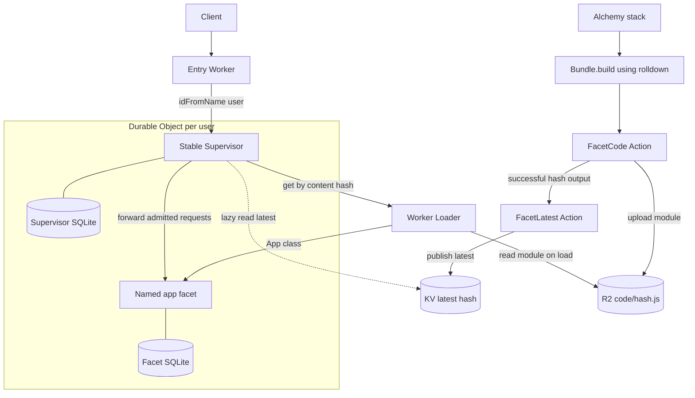
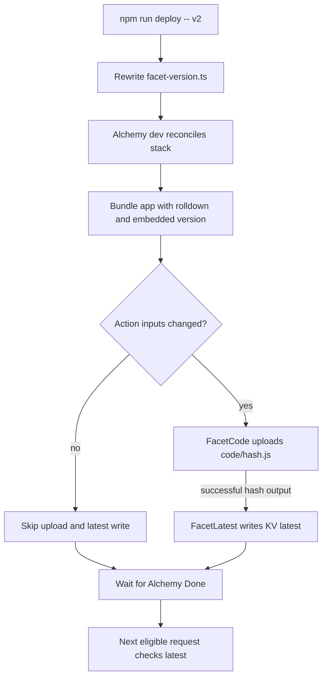
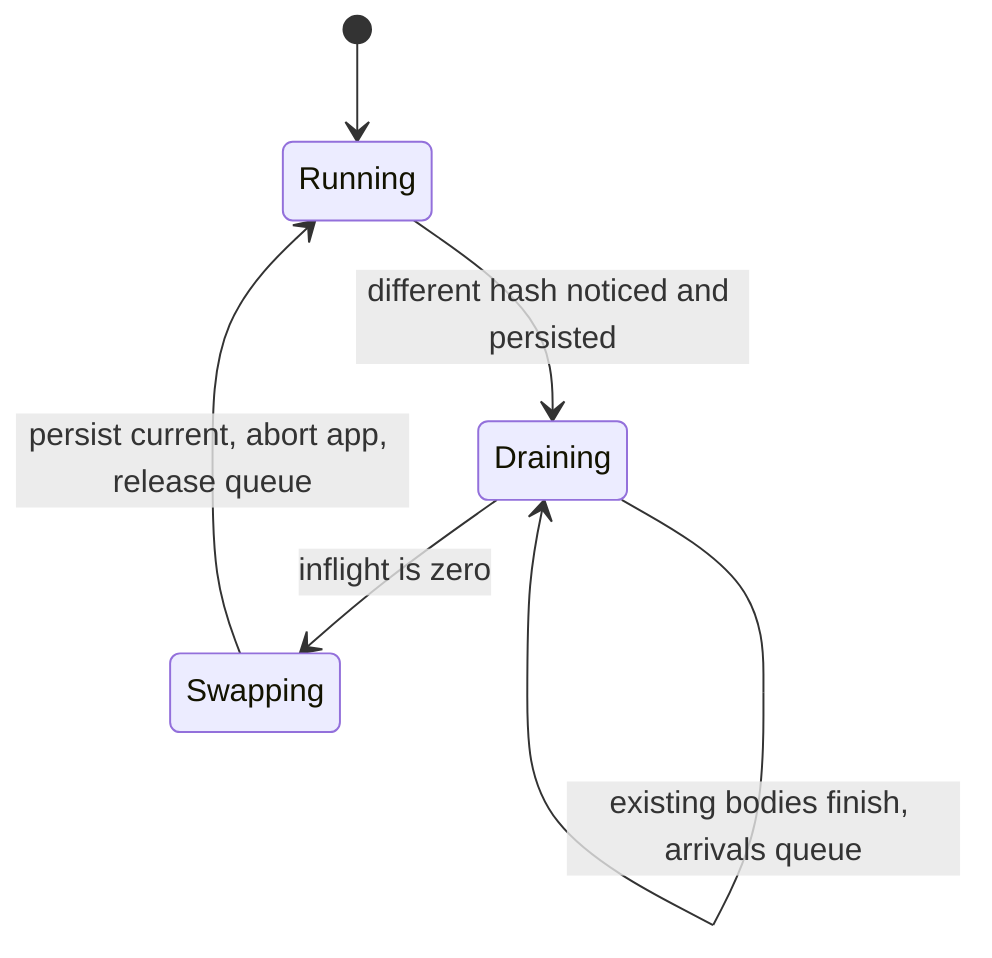
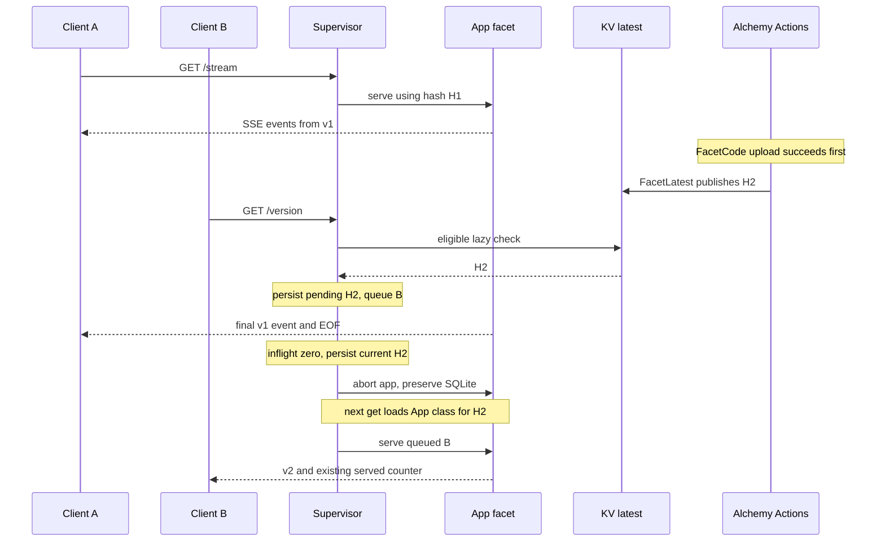

# Self-Updating Services on Durable Object Facets

## Purpose

This local prototype changes application code without interrupting requests already in progress. A stable Supervisor waits for its current work to finish before replacing a named application facet. Each user updates independently, and the facet's SQLite-backed state survives replacement.

This is a demonstration of controlled code replacement, not a guarantee against crashes or arbitrary deployment failures. It runs entirely in Alchemy's local environment, with no Cloudflare credentials or production deployment.

## The Core Idea

The entry Worker routes `/u/<user>/stream` and `/u/<user>/version` to a Supervisor selected by `idFromName(user)`. Each Supervisor owns a facet named `app`.

The **Supervisor** has stable code. It handles admission, tracks response lifetimes, and persists the current and pending content hashes in its own SQLite-backed storage.

The **Facet** contains the application logic. Worker Loader loads its module by content hash from R2. The facet has a separate SQLite database, preserved when the Supervisor aborts and recreates it. Its version label is compiled into the module; its hash is passed as `env.HASH`, avoiding a self-referential hash.

### Architecture



## Publishing Is Part of the Stack

`alchemy.run.ts` declares the local R2 bucket, KV namespace, Worker Loader binding, Supervisor namespace, and entry Worker. It calls `bundleFacet` and `publishFacet` from `infra/facet.ts` during stack evaluation.

Alchemy's `Bundle.build` uses its rolldown helper to produce one ESM module from `src/app.ts`. The file's SHA-256 hash, not the aggregate bundle hash, addresses `code/<hash>.js`. There is no separate esbuild pipeline.

Publication uses two built-in, diffed Alchemy Actions. **FacetCode** writes the module through `WriteBucketLocal`. **FacetLatest** consumes the upload's successful hash output and writes the KV value `latest`, with version and publication metadata, through `WriteNamespaceLocal`. This dependency prevents publication before the code object exists. Both use Alchemy's local emulators, not a custom HTTP publication endpoint.

A stack evaluation still bundles the source to discover changes. Identical module bytes skip the R2 upload, and identical hash/version inputs skip the KV write. Repeating the same label without changing the bundle therefore leaves both publication metadata and upload time unchanged. A forced reconciliation deliberately reruns the Actions.

### Deploy Flow



The deploy CLI only rewrites `facet-version.ts`, including a reconciliation comment. It does not bundle or upload anything itself. The comment triggers evaluation even when the label is unchanged, but is not an Action input or part of the facet bundle. After source-only edits, run the CLI again or restart dev; this is not a separate facet-source watcher.

Keep the dev process running and wait for Alchemy's **Done** message before querying the new version. Changing the facet version does not change the Supervisor Worker's bundle, so its local provider remains unchanged and existing streams survive the stack reconciliation.

## How a Supervisor Updates

**Notice.** On incoming requests, each Supervisor reads KV `latest` at most once every `CHECK_INTERVAL_MS`, which defaults to 10,000 milliseconds. Concurrent checks share a promise. There are no alarms, background polling, or update pushes. An idle object checks when traffic returns and its interval permits.

**Drain.** If the hash differs from the current and pending hashes, the Supervisor persists it as pending. New requests wait in an in-memory queue. Requests already admitted continue on the old facet.

A request remains inflight until its response body reaches EOF, errors, or is cancelled. A `TransformStream` pipe tracks that lifetime; receiving response headers alone does not release the request.

**Swap.** Only at zero inflight does the Supervisor synchronously persist `current = pending`, clear pending, and abort the named `app` facet. Aborting does not delete the facet's SQLite storage. The next facet lookup loads the new App class using the current content hash.

**Resume.** Queued requests are served by the new facet. A long stream delays only its own user's update. There is no drain deadline or forced swap; an indefinitely open stream blocks that user's update indefinitely.

### Supervisor Lifecycle



When already idle, the Supervisor can swap immediately without spending time draining.

### A Stream During an Update



## State and Forward-Only Changes

Current and pending hashes are durable; the queue, inflight count, and active connections are not. Persisting current before abort lets a restarted Supervisor select the intended code, but a Supervisor crash can still lose waiting requests and open streams.

Application state belongs in the facet's SQLite database. The demo writes a served counter before starting each stream, once per stream rather than once per event. The counter survives code replacement.

For a real long-running application, the **facet itself** must checkpoint meaningful work periodically. The Supervisor does not provide automatic checkpoints. This demo persists its counter, but does not implement resumable stream checkpoints or a migration framework. Application migrations should be repeatable and compatible with forward-only updates.

There is no rollback or canary path. A faulty release is corrected by publishing another version. The Supervisor compares hashes, not ordered release numbers; forward-only publication is a release discipline, not an enforced version-order check.

## Project Layout & Tooling

`src/` holds runtime code: entry Worker, Supervisor, version lookup and loading, response lifetime tracking, and the SSE application.

`infra/` holds the facet bundle and publication Effects used by the stack. `scripts/` contains only the deploy CLI. `test/` contains the Vitest integration test. `facet-version.ts` is the manual stack input.

Binding types come from `Env = InferEnv<typeof worker>` in `alchemy.run.ts`. Runtime modules import that type only, so stack code stays out of the Worker bundle.

Oxlint enforces correctness rules and import boundaries. Runtime cannot import infrastructure, scripts, or tests, and its imports from `alchemy.run` must be type-only. Runtime and infrastructure cannot import CLI entrypoints or tests. Oxfmt handles formatting separately.

The installed compiler is TypeScript 7.0.2. `npm run check` invokes its native compiler through `tsc --noEmit`. Effect's `@effect/tsgo` integration patches that compiler during the prepare hook and supplies build-time Effect diagnostics. The configuration retains the `@effect/language-service` plugin key, but the old JavaScript plugin package is not installed. Editors should use the Effect native language server.

Alchemy is pinned to beta.83, with an npm override to workerd 1.20261021.1 for the tested facet runtime. No custom workerd launcher or plain Wrangler fallback is used.

## What the Integration Test Proves

Vitest uses Alchemy's native `alchemy/Test/Vitest` adapter, a real local-provider sidecar, an isolated stage, and a random loopback port. The adapter owns server cleanup and scratch-stack destruction. Its test watchdog is not a Supervisor drain timeout.

The test deploys v1 twice and checks that the actual R2 upload time and KV publication metadata are unchanged. It then publishes v2 during a stream, observes a queued request through local diagnostics, and verifies all 25 old events remain v1. The queued response and a fresh stream use v2, and the facet counter survives. A second user's Supervisor updates independently. Publishing v3 and cancelling an active body verifies cancellation releases the gate.

The old writable publication endpoints return 404. Only read-only publication and Supervisor-status diagnostics remain.

## Running the Demo

With Node, npm, and Bun available, install dependencies and run the checks.

```sh
npm ci
npm run check
npm run lint
npm run fmt:check
npm test
```

Start local dev with immediate request-driven checks.

```sh
CHECK_INTERVAL_MS=0 npm run dev
```

In another terminal, publish v1, wait for Alchemy Done, and open a stream.

```sh
npm run deploy -- v1
curl -N 'http://127.0.0.1:18743/u/alice/stream?n=20&ms=500'
```

While the stream runs, publish v2 from another terminal. After Alchemy Done, request `/u/alice/version`. It waits for Alice's old stream to finish, then responds with v2. Bob's requests do not wait on Alice.

## Limits and Safety

Keep the runtime server on loopback and do not tunnel it. Only trusted local code should publish facets. The dynamic worker receives only its hash, no R2, KV, or namespace bindings, and has `globalOutbound = null`. These restrictions do not make this prototype a hardened multi-tenant sandbox.

Actions diff inputs rather than checking for storage drift. Deleting emulator data independently of Alchemy state requires a forced reconciliation. Old R2 code objects are retained for Supervisors that have not updated.

Local KV does not reproduce production propagation delay. Queue limits, crash-safe request recovery, WebSockets, production authentication, source-map publication, billing validation, and production rollout are outside this prototype. Load and application errors propagate; there is no fallback to old code.
