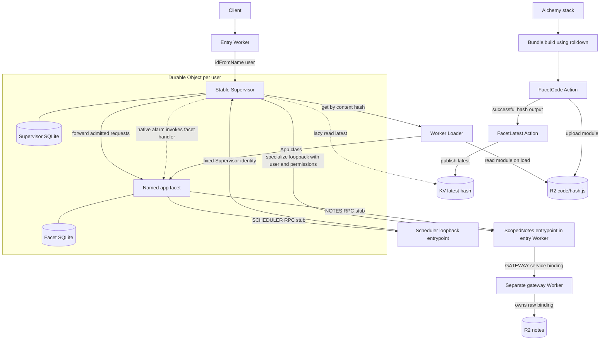
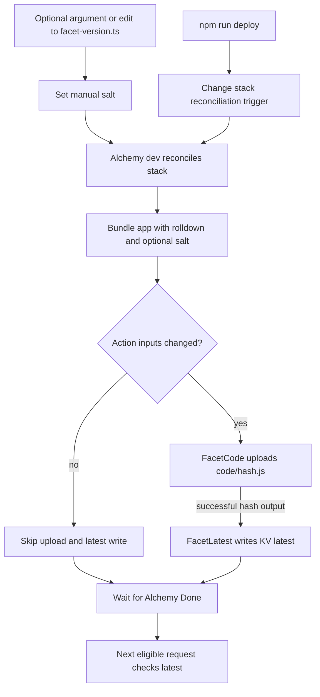
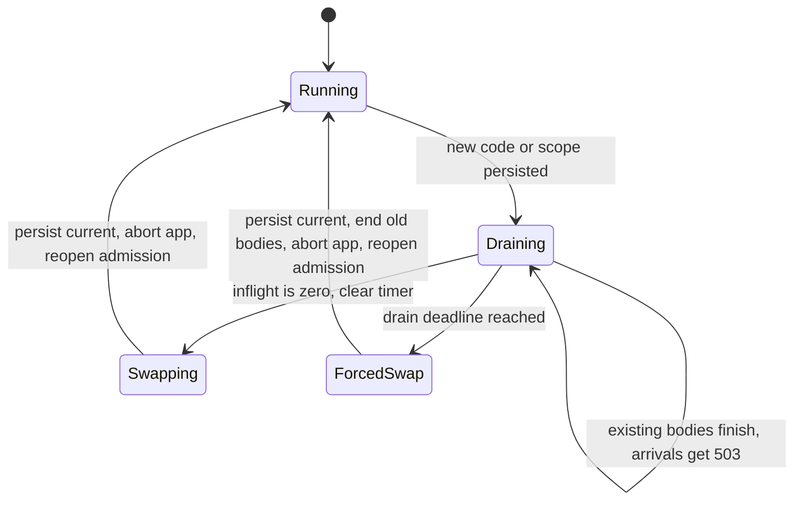
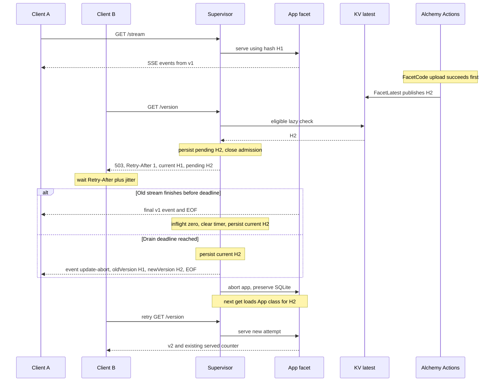

# Self-Updating Services on Durable Object Facets

## Purpose

This local prototype changes application code with a bounded drain. A stable Supervisor lets current work finish before replacing a named application facet, up to a configurable deadline. Work still running at the deadline is cut so one long stream cannot block updates forever. Each user updates independently, and the facet's SQLite-backed state survives replacement.

This is a demonstration of controlled code replacement, not a guarantee against crashes or arbitrary deployment failures. It runs entirely in Alchemy's local environment, with no Cloudflare credentials or production deployment.

## The Core Idea

The entry Worker routes `/u/<user>/stream` and `/u/<user>/version` to a Supervisor selected by `idFromName(user)`. Each Supervisor owns a facet named `app`.

HTTP routing uses Hono in the entry Worker, Supervisor, and application facet. The shared router keeps exact, encoded path matching and propagates unexpected errors to the runtime. User IDs remain raw URL segments, so encoded IDs do not alias decoded ones. Existing method handling, 404/405 responses, control-route ordering, and drain headers are unchanged. SSE handlers return their raw `Response` bodies rather than buffering or rewriting them; discarded HEAD bodies are cancelled before Hono strips them, releasing Supervisor inflight tracking. The gateway has no HTTP routes and keeps its unconditional 404 without importing Hono.

The **Supervisor** has stable code. It handles admission, tracks response lifetimes, and persists the current and pending configurations in its own SQLite-backed storage.

The **Facet** contains the application logic. Worker Loader loads its module by content hash from R2. The facet has a separate SQLite database, preserved when the Supervisor aborts and recreates it. An optional manual label is compiled into the module as a salt; no label is needed for publication. Its hash is passed as `env.HASH`, avoiding a self-referential hash. Both `/version` and SSE events show a 12-character hash in `v`, the full `hash`, and a `label` only when one is set. It receives scoped `env.NOTES` and `env.SCHEDULER` service stubs, not raw resource bindings.

### Architecture



## Capabilities Instead of Raw Bindings

The gateway Worker owns the Notes R2 bucket and exports an unscoped `Notes` entrypoint with `get`, `put`, and a revision diagnostic. Its default HTTP handler always returns 404. Only the trusted entry Worker receives the unscoped `GATEWAY` service binding; the Supervisor's user identity comes from its Durable Object ID, never facet input.

The entry Worker exports a thin `ScopedNotes` entrypoint. The Supervisor specializes its loopback binding with immutable `{ user, readOnly }` props and passes the resulting service stub into the facet's loader env. `ScopedNotes` prefixes every key with that user ID, accepts only opaque alphanumeric/underscore/hyphen keys, and checks write permission. The facet can call `get(key)` and `put(key, value)`, but cannot choose another prefix, alter props, mint a new stub, or reach the unscoped gateway. `GET/PUT /u/<user>/notes?key=note` exercises these calls from inside the facet.

Regular cross-worker service bindings accept **deployment-time** props, not caller-selected runtime props. The [Context documentation](https://developers.cloudflare.com/workers/runtime-apis/context/#specifying-ctxprops-when-using-ctxexports) explicitly reserves runtime specialization for loopback bindings. This is also visible in [workerd's implementation](https://github.com/cloudflare/workerd/blob/v1.20260918.1/src/workerd/server/server.c++#L4114-L4123): the loopback template can specialize once; an already-specialized service rejects overrides. Consequently, this sketch uses the same-worker forwarding entrypoint rather than the invalid `env.GATEWAY.Notes({ props })` shape. The local runtime test exercises actual props serialization into loader env, not mocks.

The loader cache key includes the code hash, user ID, and permission. Caching solely by hash would reuse another user's frozen env, a capability leak even if the underlying module bytes are identical.

### Refreshing Scope

The trusted local control route `PUT /u/<user>/__scope` with JSON `{"readOnly":true}` stages a new configuration with the **same hash**. Current and pending configurations include both hash and permission. Scope refresh closes admission with the same 503 retry response as a code update, waits for inflight bodies to finish or the drain deadline, and uses the same abort/recreate path. Both version headers carry the same hash during a scope-only drain. Recreated F receives the new scoped stub; its SQLite state survives. A revocation therefore takes effect **after draining or at the deadline**, not immediately. The deadline also applies when the code hash stays the same.

The scope route never reaches the facet. It is unauthenticated local test machinery, not a production authorization API. User routes themselves also lack authentication; this proves confinement of a facet's supplied capability, not protection against a client choosing another user's URL. No capability may be retained/shared outside the request-lifetime model if scope revocation is meant to be reliable.

### Gateway Deployment Boundary

Adding or changing real resources belongs on the gateway, not the Supervisor. The forwarding API must remain compatible; adding entirely new capability methods still requires teaching the trusted forwarding entrypoint how to expose them. This is a small concrete sketch, not a generic capability broker.

There is a verified **local-provider limitation** in Alchemy beta.84. Changing only the gateway's revision restarts Gateway while Api logs "No changes, using existing instance". The Supervisor's open stream survives, but its existing service channel continues reporting the old gateway revision. The integration test records this explicitly; it does **not** prove that gateway redeployments become visible without restarting Api. Do not treat local success as a production rollout guarantee. A production service-binding deployment test remains outstanding.

## Publishing Is Part of the Stack

`alchemy.run.ts` declares the local R2 bucket, KV namespace, Worker Loader binding, Supervisor namespace, and entry Worker. It calls `bundleFacet` and `publishFacet` from `infra/facet.ts` during stack evaluation.

Alchemy's `Bundle.build` uses its rolldown helper to produce one ESM module from `src/app.ts`. The file's SHA-256 hash, not the aggregate bundle hash, addresses `code/<hash>.js`. There is no separate esbuild pipeline.

Publication uses two built-in, diffed Alchemy Actions. **FacetCode** writes the module through `WriteBucketLocal`. **FacetLatest** consumes the upload's successful hash output and writes the KV value `latest`, with version and publication metadata, through `WriteNamespaceLocal`. This dependency prevents publication before the code object exists. Both use Alchemy's local emulators, not a custom HTTP publication endpoint.

A stack evaluation still bundles the source to discover changes. Identical module bytes skip the R2 upload, and identical hash/version inputs skip the KV write. Editing application source changes the hash without a label bump. Changing the optional label also changes the module bytes, so it forces publication even when the source is unchanged. An unchanged source and label leave both publication metadata and upload time unchanged. A forced reconciliation deliberately reruns the Actions.

### Deploy Flow



The normal workflow is to edit `src/app.ts` or its runtime dependencies, then run `npm run deploy` while Alchemy dev is running. With no argument, the CLI leaves `facet-version.ts` untouched, including its comments. It only changes a comment in the stack-imported `infra/reconcile.ts` to request another evaluation. That trigger is not bundled into the facet and is not an Action input, so reconciling unchanged code is a publication no-op. Alchemy watches the stack import graph, not the facet's separately bundled source; this command supplies the missing evaluation trigger. Starting dev also evaluates the current source without needing a label.

`facet-version.ts` defaults to "v1". It is an optional manual salt, not a release counter. `npm run deploy -- my-label` sets it and reconciles; `npm run deploy -- ''` clears it. Reusing the same label does not force publication. Change the label only when you want to change the hash without editing application code. The CLI does not bundle or upload anything itself.

Keep the dev process running and wait for Alchemy's **Done** message before querying the new version. Changing the application source or optional salt does not change the Supervisor Worker's bundle, so its local provider remains unchanged and existing streams survive the stack reconciliation.

## How a Supervisor Updates

**Notice.** On incoming requests and application alarm deliveries, each Supervisor reads KV `latest` at most once every `CHECK_INTERVAL_MS`, which defaults to 10,000 milliseconds. Concurrent checks share a promise. There is no background update polling or update push. An idle object checks when traffic returns or its application alarm fires, and its interval permits.

**Drain.** If the hash differs from the current and pending hashes, the Supervisor persists it as pending. New application requests immediately receive **503 Service Unavailable**; the Supervisor never queues or forwards them. Requests already admitted continue on the old facet.

The response includes `Retry-After: 1`, `X-Current-Version`, `X-Pending-Version`, and `Cache-Control: no-store`. Version headers contain content hashes, not labels such as v1. Clients should wait at least the indicated seconds and add jitter before retrying, with a retry budget or cancellation policy. A 503 from this gate means the request did not reach the facet; other failures do not carry that guarantee. Local status and scope-control routes bypass application admission.

A request remains inflight until its response body reaches EOF, errors, is cancelled, or is cut at the deadline. A Supervisor-owned response wrapper tracks that lifetime; receiving response headers alone does not release the request.

**Swap.** At zero inflight, the Supervisor clears the drain timer, synchronously persists `current = pending`, clears pending, and aborts the named `app` facet. Aborting does not delete the facet's SQLite storage. The next facet lookup loads the new App class using the current content hash.

**Deadline.** The first pending code or scope change starts a `DRAIN_DEADLINE_MS` timer, defaulting to 30,000 milliseconds. Changing the pending target does not extend it. If work is still active when the timer fires, the Supervisor commits pending and force-swaps, terminating old requests and aborting the facet. Its response wrapper first appends a final `event: update-abort` to open SSE bodies, then closes them. The event's JSON data contains `reason: "drain-deadline"`, `oldVersion`, and `newVersion`; versions are hashes and are equal for a scope-only swap. This hint is best-effort if the connection has already failed. Non-SSE bodies error instead of receiving an SSE suffix. Work still awaiting headers receives a retryable 503 if facet abort rejects its fetch.

The timer uses `setTimeout`, not a Durable Object alarm. [Scheduled timers prevent hibernation](https://developers.cloudflare.com/durable-objects/concepts/durable-object-lifecycle/), and this timer only needs to act on live, in-memory requests. It is not a crash-recovery scheduler or an exact wall-clock guarantee during runtime failure. On Supervisor reconstruction, inflight tracking cannot be recovered, so any persisted pending change commits immediately rather than starting another drain window.

**Retry.** After either swap path, a new client attempt is served by the new facet. A long stream delays only its own user's update, for at most the drain window while the runtime remains live; other users can still make progress. Clients should handle both admission 503s and interrupted streams. An abort does not undo completed writes or external calls, so retrying work needs application-level idempotency or checkpoints.

### Supervisor Lifecycle



When already idle, the Supervisor can swap immediately without spending time draining.

### A Stream During an Update



## Alarms Through the Supervisor

Facets cannot own native alarms. The Supervisor supplies `env.SCHEDULER`, a loopback service stub with `setAlarm(time: number | Date)`, `getAlarm()`, and `deleteAlarm()`. Like Notes, its immutable props fix the Supervisor identity; the facet cannot select another object or obtain its raw namespace/stub. There is one logical alarm per Supervisor. Setting another time replaces it, and deleting cancels it.

The due time and a unique scheduling token live in the Supervisor's SQLite-backed storage. Setting/deleting that record and the native storage alarm share a transaction. Neither a code/scope swap nor Supervisor reconstruction resets the schedule. `getAlarm()` reports the logical due time, even when the physical alarm was postponed for draining; while that delivery is executing it returns null unless the handler has scheduled a replacement. Tokens keep a handler's rearm safe even when it uses the same timestamp.

When the native `Supervisor.alarm()` fires, it performs the usual interval-limited KV check before loading F. Pending drains postpone the physical alarm by two seconds without consuming the logical alarm or extending the hard drain timer. After swapping, the next delivery loads current code. Executing handlers count as inflight work, so a code/scope change drains them just like requests. A deadline abort rejects the old handler and leaves its durable alarm record for retry. On Supervisor restart, pending configurations commit immediately as before; native alarm persistence/retries recover delivery, not the in-memory drain timer.

Cloudflare reserves `alarm` on Durable Object RPC stubs. A tiny `F.dispatchAlarm(info)` bridge therefore invokes `F.alarm(info)`. The Supervisor copies the runtime's non-serializable invocation metadata into a plain object, preserving the logical scheduled time and native retry information.

Errors propagate to the native alarm handler, using [Cloudflare's at-least-once retries](https://developers.cloudflare.com/durable-objects/api/alarms/) rather than a custom retry loop. Handlers **must be idempotent**: aborts or failures can repeat effects that already completed. Native retries use exponential backoff starting at two seconds, with up to six retries for the most recent `setAlarm`; this is not unlimited delivery. A logical record can remain after retry exhaustion and needs explicit rearming. Rearming/deleting during a handler follows native replacement/cancellation semantics; cancellation does not undo running work.

The demo's `GET/PUT/DELETE /u/<user>/alarm` calls the scheduler from inside F. PUT accepts JSON `{"time": <epoch milliseconds>}`. GET reports `scheduled`, the facet's persistent firing `count`, and `last` with the handling code hash. These routes have the same local-only, unauthenticated status as the rest of this demo.

## State and Forward-Only Changes

Current and pending code/scope configurations are durable; active requests and the timer are not. There is no waiting-request queue. Persisting current before abort lets a restarted Supervisor select the intended code. A pending configuration recovered on wake is committed immediately because there is no recoverable inflight set to drain. A Supervisor crash can still lose open streams without a final abort event. Retry scheduling belongs to clients, not Supervisor memory.

The application alarm schedule belongs to Supervisor storage; handler effects belong to the facet. Application state belongs in the facet's SQLite database. The demo writes a served counter before starting each stream, once per stream rather than once per event. The counter survives code replacement.

For a real long-running application, the **facet itself** must checkpoint meaningful work periodically. The Supervisor does not provide automatic checkpoints. This demo persists its counter, but does not implement resumable stream checkpoints or a migration framework. Application migrations should be repeatable and compatible with forward-only updates.

There is no rollback or canary path. A faulty release is corrected by publishing another version. The Supervisor compares hashes, not ordered release numbers; forward-only publication is a release discipline, not an enforced version-order check.

## Project Layout & Tooling

`src/` holds runtime code: entry Worker, Supervisor, shared Hono router, version lookup and loading, response lifetime tracking, and the SSE application.

`infra/` holds the facet bundle and publication Effects used by the stack. `scripts/` contains only the deploy CLI. `test/` contains typed Vitest integration and regression tests. `facet-version.ts` is the optional manual salt; `infra/reconcile.ts` is the CLI's stack-only evaluation trigger.

Binding types come from `Env = InferEnv<typeof worker>` and `GatewayEnv = InferEnv<ReturnType<typeof gatewayWorker>>` in `alchemy.run.ts`. Runtime modules import that type only, so stack code stays out of the Worker bundle.

Oxlint runs type-aware correctness rules, the Effect recommended preset, Promise checks, type-only import checks, and focused/disabled-test checks. Warnings fail the lint command. Runtime cannot import infrastructure, scripts, or tests, and its imports from `alchemy.run` must be type-only. Runtime and infrastructure cannot import CLI entrypoints or tests. Oxfmt handles formatting and import order separately. Imports are grouped as Node builtins, external packages, project-boundary imports (the stack, infra, and src), then relative modules, with blank lines between groups. Type imports stay alongside values from the same group; Oxlint still enforces type-only usage. Side-effect imports keep their evaluation order. Package keys and scripts are sorted too.

The installed compiler is TypeScript 7.0.2. `npm run check` invokes its native compiler through `tsc --noEmit`. Effect's `@effect/tsgo` integration patches TypeScript, Oxlint, and its `oxlint-tsgolint` backend during the prepare hook. Those three packages are pinned to versions supported by the installed integration; upgrade them together against its compatibility table. Effect diagnostics run through Oxlint, not twice through both lint and typecheck (`diagnostics: false` in the plugin options). Scripts and tests are TypeScript, included in the strict typecheck and type-aware linting; `allowJs` is disabled. Type-only imports are explicit through `verbatimModuleSyntax`. The configuration retains the `@effect/language-service` plugin key, but the old JavaScript plugin package is not installed. Editors should use the Effect native language server.

Alchemy and its separate `@alchemy.run/cloudflare` provider are pinned to beta.84. Cloudflare imports and inferred binding types come from the provider package; bundling, Actions, local state, and the Vitest adapter remain in core Alchemy. The provider runtime pins workerd 1.20261012.1, which passes the facet integration suite without a direct workerd dependency or npm override. Both stack Workers and dynamically loaded facets use compatibility date 2026-10-12, within that binary's supported range. No custom workerd launcher or plain Wrangler fallback is used.

## What the Integration Test Proves

Vitest uses Alchemy's native `alchemy/Test/Vitest` adapter, a real local-provider sidecar, an isolated stage, and a random loopback port. The adapter owns server cleanup and scratch-stack destruction. Tests set `DRAIN_DEADLINE_MS=3000` and use a separate watchdog for the full test run.

The test first deploys without a manual label and checks the short-hash display. It changes only application source under a fixed label and verifies publication and a swap in an existing Supervisor, then redeploys unchanged source to check the no-op. Label-only updates exercise publication and swapping without changing application source. The test also deploys v1 twice and checks that the actual R2 upload time and KV publication metadata are unchanged. It then publishes v2 during a stream, checks that a new request immediately receives 503 with retry and current/pending hash headers while the old body remains inflight, and verifies all 25 old events remain v1. A retry after draining and a fresh stream use v2, and the facet counter survives. A second user's Supervisor updates independently. Publishing v3 and cancelling an active body verifies cancellation releases inflight and permits a successful retry.

The old writable publication endpoints return 404. Read-only publication and Supervisor-status diagnostics remain, alongside the trusted local scope-control route. The test additionally checks actual facet RPC reads/writes, isolation between Alice and Bob with the same code hash, path-escape rejection, gateway-redeploy behavior (including the pinned local channel limitation), and read-only scope refresh during an active stream. Scope-only drains reject writes with 503 and equal current/pending hash headers; after draining, retried writes receive 403 under the new permission. Bob can still write during Alice's scope drain. Long-stream tests exercise both code and scope deadlines, check the final abort event's old/new hashes, and verify that retries use the new code or permission. Wrapper unit tests cover EOF, cancellation, pending reads, and non-SSE aborts. Alarm integration cases exercise real scheduling, cancellation, getAlarm inside a handler, delivery after an alarm-driven code swap without intervening traffic, deferral through both normal and deadline drains, and native retry after a facet exception. Supervisor unit tests additionally cover rearming at the same timestamp, deletion during a failed delivery, stale physical callbacks, an inflight alarm interrupted by the hard deadline, and reconstruction with a persisted pending swap/alarm. These reconstruction tests model storage reuse; they do not simulate a real process crash. Routing regression tests cover literal encoded paths, raw user IDs, forwarded methods/bodies/queries, exact 404/405 handling, query decoding, validation, propagated errors, control-route update ordering, and HEAD cancellation without leaked inflight work. An isolated CLI test checks that no-argument deploys preserve the salt file byte-for-byte, explicit arguments set it safely, and an empty argument clears it.

## Running the Demo

Use Node 24.11.1+ (or 25.1+) and npm. The dev command runs the project-local Alchemy CLI under Node, using its Oxc loader for the TypeScript stack. The deploy CLI runs directly as `node scripts/deploy.ts`, using Node's native type stripping and only erasable TypeScript syntax. Install dependencies and run the checks.

```sh
npm ci
npm run check
npm run lint
npm run fmt:check
npm test
```

Start local dev with immediate request-driven checks.

```sh
CHECK_INTERVAL_MS=0 npm run dev
```

In another terminal, reconcile the current source, wait for Alchemy Done, and open a stream. No manual version is needed.

```sh
npm run deploy
curl -N 'http://127.0.0.1:18743/u/alice/stream?n=20&ms=500'
```

While the stream runs, edit the facet source and run `npm run deploy` again. Or run `npm run deploy -- demo-update` to force a new hash using only the optional salt. After Alchemy Done, request `/u/alice/version`. It immediately returns 503 with retry and version headers while Alice's old stream is active. Wait at least one second plus a little jitter, then retry; once the stream finishes or the deadline cuts it, the response contains the new short hash in `v` and its full `hash`, plus the optional `label` if set. A cut SSE stream ends with an `update-abort` event telling the client to retry. Bob's requests are unaffected by Alice's drain. Set `DRAIN_DEADLINE_MS` alongside `CHECK_INTERVAL_MS` when starting dev to change the default 30-second drain window.

## Limits and Safety

Keep both runtime servers on loopback and do not tunnel them. Only trusted local code should publish facets. The dynamic worker receives only its hash and scoped Notes/scheduler service stubs, no raw R2, KV, or namespace bindings, and has `globalOutbound = null`. These restrictions do not make this prototype a hardened multi-tenant sandbox.

Actions diff inputs rather than checking for storage drift. Deleting emulator data independently of Alchemy state requires a forced reconciliation. Old R2 code objects are retained for Supervisors that have not updated.

Local KV does not reproduce production propagation delay. Crash-safe request recovery, WebSockets, production authentication, source-map publication, billing validation, and production rollout are outside this prototype. Load and application errors propagate; there is no fallback to old code.
