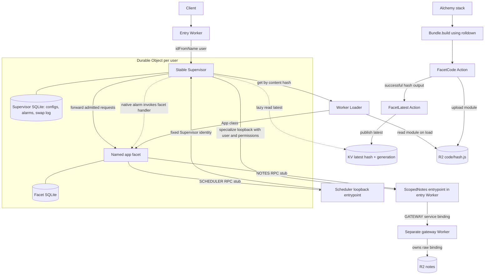
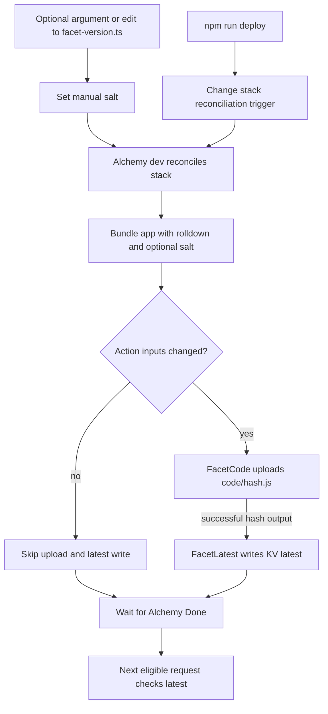
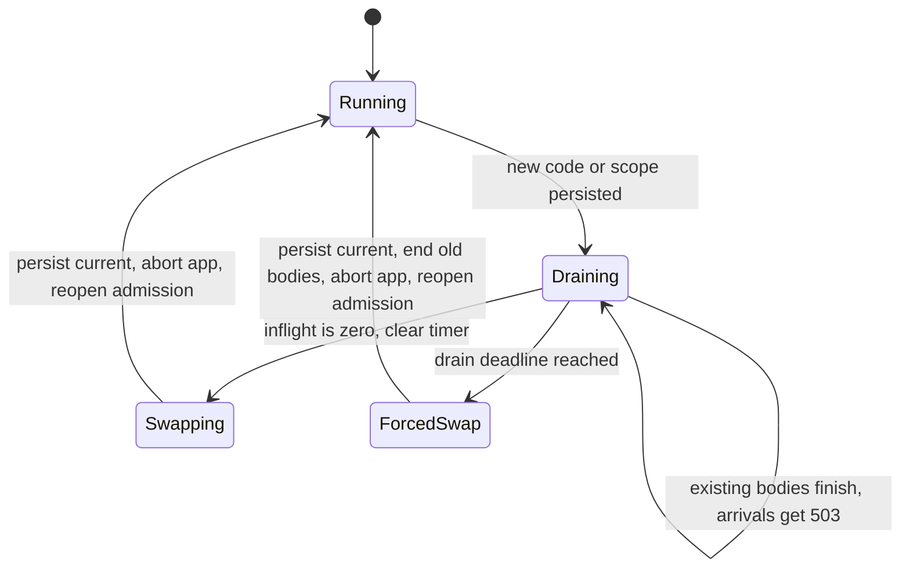
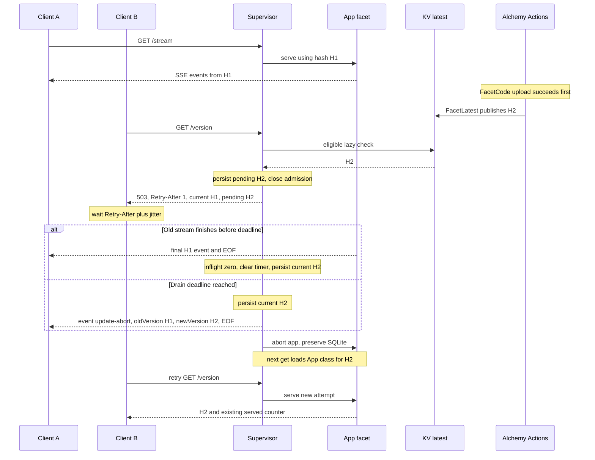

# Architecture

[Setup and demo](../README.md) · [Development](DEVELOPMENT.md)

## Purpose

This local prototype changes application code with a bounded drain. A stable Supervisor lets current work finish before replacing a named application facet, up to a configurable deadline. Work still running at the deadline is cut to bound the drain window. Each user updates independently, and the facet's SQLite-backed state survives replacement.

This is a demonstration of controlled code replacement, not a guarantee against crashes or arbitrary deployment failures. The checked-in stack runs in Alchemy's local environment and rejects non-dev execution.

## The Core Idea

The entry Worker routes `/u/<user>/stream` and `/u/<user>/version` to a Supervisor selected by `idFromName(user)`. Each Supervisor owns a facet named `app`.

HTTP routing uses Hono in the entry Worker, Supervisor, and application facet. The shared router keeps exact, encoded path matching and propagates unexpected errors to the runtime.

User IDs are raw URL segments, so encoded IDs do not alias decoded ones. Health, publication, status, version, and stream routes accept GET and automatic HEAD. Scope control accepts PUT, notes accept GET/PUT, and alarms accept GET/PUT/DELETE. Unsupported methods on these routes return 405.

SSE handlers return raw response bodies. The shared router cancels discarded HEAD bodies before Hono strips them, releasing Supervisor inflight tracking. The gateway exposes RPC only; its HTTP handler returns 404.

The **Supervisor** has stable code. It handles admission, tracks response lifetimes, and persists the current and pending configurations in its own SQLite-backed storage.

The **Facet** contains the application logic. Worker Loader loads its module by content hash from R2. The facet has a separate SQLite database, preserved when the Supervisor aborts and recreates it. An optional manual label is compiled into the module as a salt; no label is needed for publication. Its hash is passed as `env.HASH`, avoiding a self-referential hash. Both `/version` and SSE events show a 12-character hash in `v`, the full `hash`, and a `label` only when one is set. It receives scoped `env.NOTES` and `env.SCHEDULER` service stubs, not raw resource bindings.

### Architecture

## Capabilities Instead of Raw Bindings

The gateway Worker owns the Notes R2 bucket and exports an unscoped `Notes` entrypoint with `get`, `put`, and a revision diagnostic. Its default HTTP handler always returns 404. Only the trusted entry Worker receives the unscoped `GATEWAY` service binding; the Supervisor's user identity comes from its Durable Object ID, never facet input.

The entry Worker exports a thin `ScopedNotes` entrypoint. The Supervisor specializes its loopback binding with immutable `{ user, readOnly }` props and passes the resulting service stub into the facet's loader env. `ScopedNotes` prefixes every key with that user ID, accepts only opaque alphanumeric/underscore/hyphen keys, and checks write permission. The facet can call `get(key)` and `put(key, value)`, but cannot choose another prefix, alter props, mint a new stub, or reach the unscoped gateway. `GET/PUT /u/<user>/notes?key=note` exercises these calls from inside the facet.

Cross-worker service bindings accept deployment-time props. Runtime specialization is available on [loopback bindings](https://developers.cloudflare.com/workers/runtime-apis/context/#specifying-ctxprops-when-using-ctxexports), so the Supervisor uses a same-worker forwarding entrypoint to create each scoped stub. The local integration test exercises props serialization into the loader environment.

The loader cache key includes the code hash, user ID, and permission. Caching solely by hash would reuse another user's frozen env, a capability leak even if the underlying module bytes are identical.

### Refreshing Scope

The trusted local control route `PUT /u/<user>/__scope` with JSON `{"readOnly":true}` stages a new configuration with the **same hash**. Current and pending configurations include hash, generation, and permission. An unchanged target permission returns `{ accepted: true, changed: false }` without starting another drain. Scope refresh closes admission with the same 503 retry response as a code update, waits for inflight bodies to finish or the drain deadline, and uses the same abort/recreate path. Both version headers carry the same hash during a scope-only drain. The recreated facet receives the new scoped stub; its SQLite state survives. A revocation therefore takes effect **after draining or at the deadline**, not immediately. The deadline also applies when the code hash stays the same.

The scope route never reaches the facet. It is unauthenticated local test machinery, not a production authorization API. User routes themselves also lack authentication; capability confinement does not prevent a client from choosing another user's URL. No capability may be retained/shared outside the request-lifetime model if scope revocation is meant to be reliable.

### Gateway Deployment Boundary

Adding or changing real resources belongs on the gateway, not the Supervisor. The forwarding API must remain compatible; adding entirely new capability methods still requires teaching the trusted forwarding entrypoint how to expose them.

In Alchemy beta.84's local provider, a gateway-only revision change restarts Gateway while Api keeps its existing instance. The Supervisor's open stream survives, but its service channel continues reporting the previous gateway revision. The integration test records this limitation. A manual Cloudflare trial reaches the new gateway from an existing Supervisor; the stale channel is reproducible only locally so far. There is no automated production rollout test.

## Publishing Is Part of the Stack

`alchemy.run.ts` declares the local R2 bucket, KV namespace, Worker Loader binding, Supervisor namespace, and entry Worker. It defines and calls `bundleFacet` and `publishFacet` during stack evaluation.

Alchemy's `Bundle.build` uses its rolldown helper to produce one ESM module from `src/app.ts`. The file's SHA-256 hash, not the aggregate bundle hash, addresses `code/<hash>.js`.

Publication uses two built-in, diffed Alchemy Actions. **FacetCode** takes only the content hash as its persisted, diffed input and writes the module through `WriteBucketLocal`. Module bytes come from the evaluation closure, so the bundle does not enter Action state. **FacetLatest** consumes the upload's successful hash output and writes `{ hash, generation }` to KV `latest`, with version and publication metadata, through `WriteNamespaceLocal`. This dependency prevents publication before the code object exists. Both write through Alchemy's local emulators.

Each stack evaluation bundles the source to discover changes. Identical module bytes skip the R2 upload, and identical hash/version inputs skip the KV write. Editing application source changes the hash without a label bump. Changing the optional label also changes the module bytes, so it forces publication even when the source is unchanged. Unchanged source and label leave both publication metadata and upload time unchanged. A forced reconciliation deliberately reruns the Actions.

### Deploy Flow

The deploy CLI requests stack evaluation while Alchemy dev is running. The optional label salt changes module bytes; the reconciliation nonce only triggers evaluation. See [Development](DEVELOPMENT.md#local-execution) for commands and salt behavior.

Changes confined to the application source or salt leave the Supervisor Worker's bundle unchanged, so existing streams survive stack reconciliation. Shared runtime dependencies can also change the stable Workers; editing `src/router.ts`, for example, redeploys both the entry Worker and Supervisor.

## How a Supervisor Updates

**Notice.** On incoming requests and application alarm deliveries, each Supervisor reads KV `latest` at most once every `CHECK_INTERVAL_MS`, which defaults to 10,000 milliseconds. Concurrent checks share a promise. There is no background update polling or update push. An idle object checks when traffic returns or its application alarm fires, and its interval permits.

Before staging, the Supervisor validates a lowercase 64-character hash and positive safe-integer generation. It ignores generations at or below the highest current/pending generation, preventing stale KV reads from downgrading code. It reads R2 and invokes a side-effect-free default Worker entrypoint to compile/warm the loader without constructing the durable facet. KV read, missing-code, and module compilation failures keep serving current; the next eligible check retries. This validates module loading, not application behavior.

**Drain.** A newer generation with a different target hash is persisted as pending. Republishing the same target hash only advances its generation, without another drain. New application requests immediately receive **503 Service Unavailable**; the Supervisor never queues or forwards them. Requests already admitted continue on the old facet.

The response includes `Retry-After: 1`, `X-Current-Version`, `X-Pending-Version`, and `Cache-Control: no-store`. Version headers contain content hashes, not labels such as v1. Clients should wait at least the indicated seconds and add jitter before retrying, with a retry budget or cancellation policy. A 503 from this gate means the request did not reach the facet; other failures do not carry that guarantee. Local status and scope-control routes bypass application admission.

A request remains inflight until its response body reaches EOF, errors, is cancelled, or is cut at the deadline. A Supervisor-owned response wrapper tracks that lifetime; receiving response headers alone does not release the request.

**Swap.** At zero inflight, the Supervisor clears the drain timer, synchronously persists `current = pending`, clears pending, and aborts the named `app` facet. Aborting does not delete the facet's SQLite storage. The next facet lookup loads the new App class using the current content hash.

**Deadline.** The first pending code or scope change starts a `DRAIN_DEADLINE_MS` timer, defaulting to 30,000 milliseconds. Changing the pending target does not extend it. If work is still active when the timer fires, the Supervisor commits pending and force-swaps, terminating old requests and aborting the facet. Its response wrapper first appends a final `event: update-abort` to open SSE bodies, then closes them. The event's JSON data contains `reason: "drain-deadline"`, `oldVersion`, and `newVersion`; versions are hashes and are equal for a scope-only swap. This hint is best-effort if the connection has already failed. Non-SSE bodies error instead of receiving an SSE suffix. Work still awaiting headers receives a retryable 503 if facet abort rejects its fetch.

The timer uses `setTimeout`, not a Durable Object alarm. [Scheduled timers prevent hibernation](https://developers.cloudflare.com/durable-objects/concepts/durable-object-lifecycle/), and this timer only needs to act on live, in-memory requests. It is not a crash-recovery scheduler or an exact wall-clock guarantee during runtime failure. The in-memory timer does not survive Supervisor reconstruction.

**Retry.** After either swap path, a new client attempt is served by the new facet. A long stream delays only its own user's update, for at most the drain window while the runtime remains live; other users can still make progress. Clients should handle both admission 503s and interrupted streams. An abort does not undo completed writes or external calls, so retrying work needs application-level idempotency or checkpoints.

### Supervisor Lifecycle

When already idle, the Supervisor can swap immediately without spending time draining.

### Swap History

Each completed configuration commit appends a row to the Supervisor's own SQLite `swaps` table, atomically with the current/pending configuration change. It retains only the latest 100 rows. Initial activation is included with a null old hash; this is diagnostic history, not a rollback mechanism.

`GET /u/<user>/__status?swaps=20` returns `{ current, pending, pendingSince, inflight, swapping, swaps }`, with swap rows newest first. `pendingSince` is null when no configuration is pending. The `swaps` count defaults to 20, must be a non-negative safe integer, and is capped at 100; `swaps=0` omits history rows, and invalid values return 400. This read-only route bypasses update checks and admission, so reading it never triggers an update. Other methods return 405 (HEAD reads without a response body).

Rows contain `id`, `oldHash`, `newHash`, `kind` (`code` for a hash change, `scope` for a same-hash configuration commit), `pendingSince`, `swappedAt`, `forced`, `abortedStreams`, and `restartCommit`. Timestamps are epoch milliseconds; subtract them for drain duration. The original pending time survives replacement of a pending target. A combined code/scope change is classified as code.

`forced` marks the deadline path. `abortedStreams` counts response bodies still tracked at that deadline, including non-SSE bodies, but not alarm handlers or requests awaiting headers. `restartCommit` marks pending state committed during Supervisor reconstruction; those commits are not forced and have no recoverable active streams. If a persisted pending configuration has no timestamp, the row uses the commit time as its pending time.

### A Stream During an Update

## Alarms Through the Supervisor

Facets cannot own native alarms. The Supervisor supplies `env.SCHEDULER`, a loopback service stub with `setAlarm(time: number | Date)`, `getAlarm()`, and `deleteAlarm()`. Like Notes, its immutable props fix the Supervisor identity; the facet cannot select another object or obtain its raw namespace/stub. There is one logical alarm per Supervisor. Setting another time replaces it, and deleting cancels it.

The due time and a unique scheduling token live in the Supervisor's SQLite-backed storage. Setting/deleting that record and the native storage alarm share a transaction. Neither a code/scope swap nor Supervisor reconstruction resets the schedule. `getAlarm()` reports the logical due time, even when the physical alarm was postponed for draining; while that delivery is executing it returns null unless the handler has scheduled a replacement. Tokens keep a handler's rearm safe even when it uses the same timestamp.

When the native `Supervisor.alarm()` fires, it performs the usual interval-limited KV check before loading the facet. Pending drains postpone the physical alarm by two seconds without consuming the logical alarm or extending the hard drain timer. After swapping, the next delivery loads current code. Executing handlers count as inflight work, so a code/scope change drains them just like requests. A deadline abort rejects the old handler and leaves its durable alarm record for retry. Native alarm persistence and retries recover delivery across Supervisor restarts.

Cloudflare reserves `alarm` on Durable Object RPC stubs. A tiny `F.dispatchAlarm(info)` bridge therefore invokes `F.alarm(info)`. The Supervisor copies the runtime's non-serializable invocation metadata into a plain object, preserving the logical scheduled time and native retry information.

Errors propagate to the native alarm handler, using [Cloudflare's at-least-once retries](https://developers.cloudflare.com/durable-objects/api/alarms/) rather than a custom retry loop. Handlers **must be idempotent**: aborts or failures can repeat effects that already completed. Native retries use exponential backoff starting at two seconds, with up to six retries for the most recent `setAlarm`; this is not unlimited delivery. A logical record can remain after retry exhaustion and needs explicit rearming. Rearming/deleting during a handler follows native replacement/cancellation semantics; cancellation does not undo running work.

The demo's `GET/PUT/DELETE /u/<user>/alarm` calls the scheduler from inside the facet. PUT accepts JSON `{"time": <epoch milliseconds>}`. GET reports `scheduled`, the facet's persistent firing `count`, and `last` with the handling code hash. The handler awaits `getAlarm()` before atomically writing its counter and last-delivery record, avoiding partial writes if that RPC fails.

## State and Forward-Only Changes

Current and pending code/scope configurations are durable; active requests and the timer are not. There is no waiting-request queue. Persisting current before abort lets a restarted Supervisor select the intended code. A pending configuration recovered on wake is committed immediately because there is no recoverable inflight set to drain. A Supervisor crash can still lose open streams without a final abort event. Retry scheduling belongs to clients, not Supervisor memory.

The application alarm schedule belongs to Supervisor storage; handler effects belong to the facet. Application state belongs in the facet's SQLite database. The demo writes a served counter before starting each stream, once per stream rather than once per event. The counter survives code replacement.

For a real long-running application, the **facet itself** must checkpoint meaningful work periodically. The Supervisor does not provide automatic checkpoints. This demo persists its counter, but does not implement resumable stream checkpoints or a migration framework. Application migrations should be repeatable and compatible with forward-only updates.

There is no rollback or canary path. A faulty release is corrected by publishing another version. The Supervisor enforces monotonically increasing publication generations, not ordered content hashes. Deliberately publishing an older hash with a newer generation is allowed. Generation is derived from the clock and the previous successful Alchemy Action output, so stalled/regressing clocks still advance it. Use one serialized deploy writer sharing the same Alchemy state; independent state stores or lost deployment state cannot guarantee global ordering.

## Limits and Safety

Keep both runtime servers on loopback and do not tunnel them. Only trusted local code should publish facets. The dynamic worker receives only its hash and scoped Notes/scheduler service stubs, no raw R2, KV, or namespace bindings, and has `globalOutbound = null`. These restrictions do not make this prototype a hardened multi-tenant sandbox.

Actions diff inputs rather than checking for storage drift. Deleting emulator data independently of Alchemy state requires a forced reconciliation. Old R2 code objects are retained for Supervisors that have not updated.

Local KV does not reproduce production propagation delay. Crash-safe request recovery, WebSockets, production authentication, source-map publication, billing validation, and production rollout are outside this prototype. Preflight failures retain the current code. Errors after a successful swap still propagate; there is no automatic runtime rollback.
