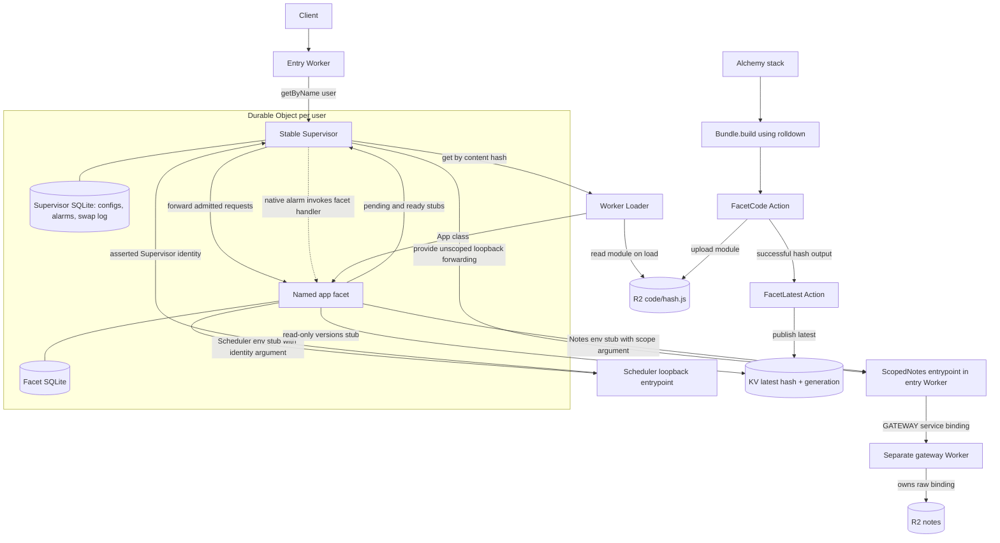
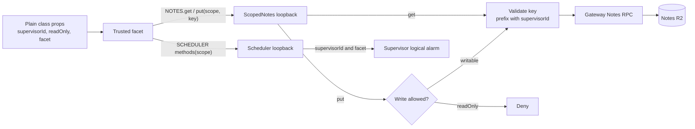
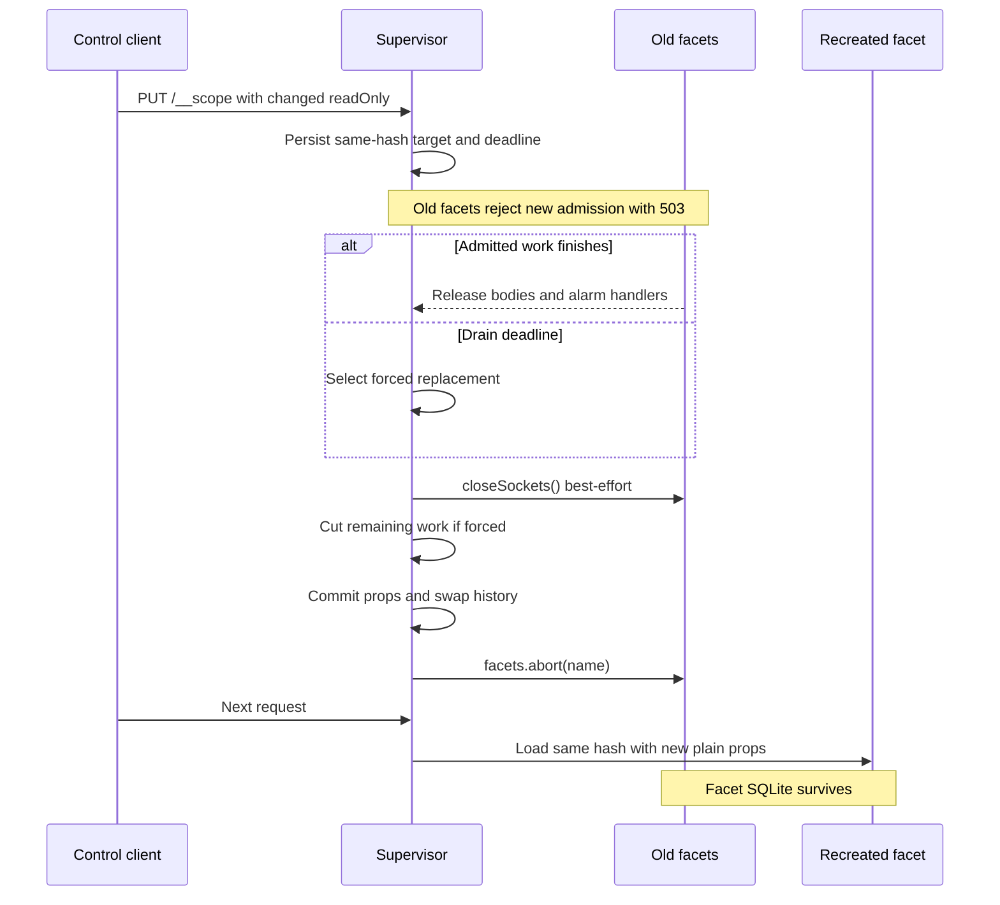
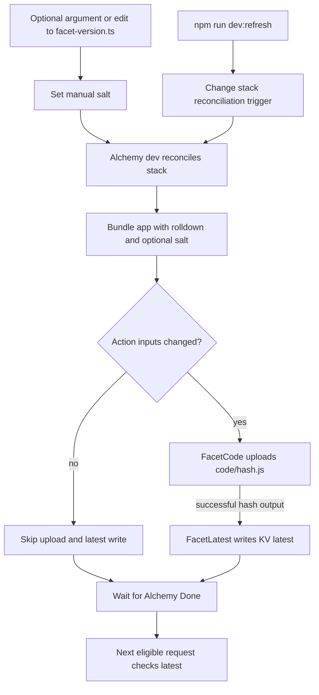
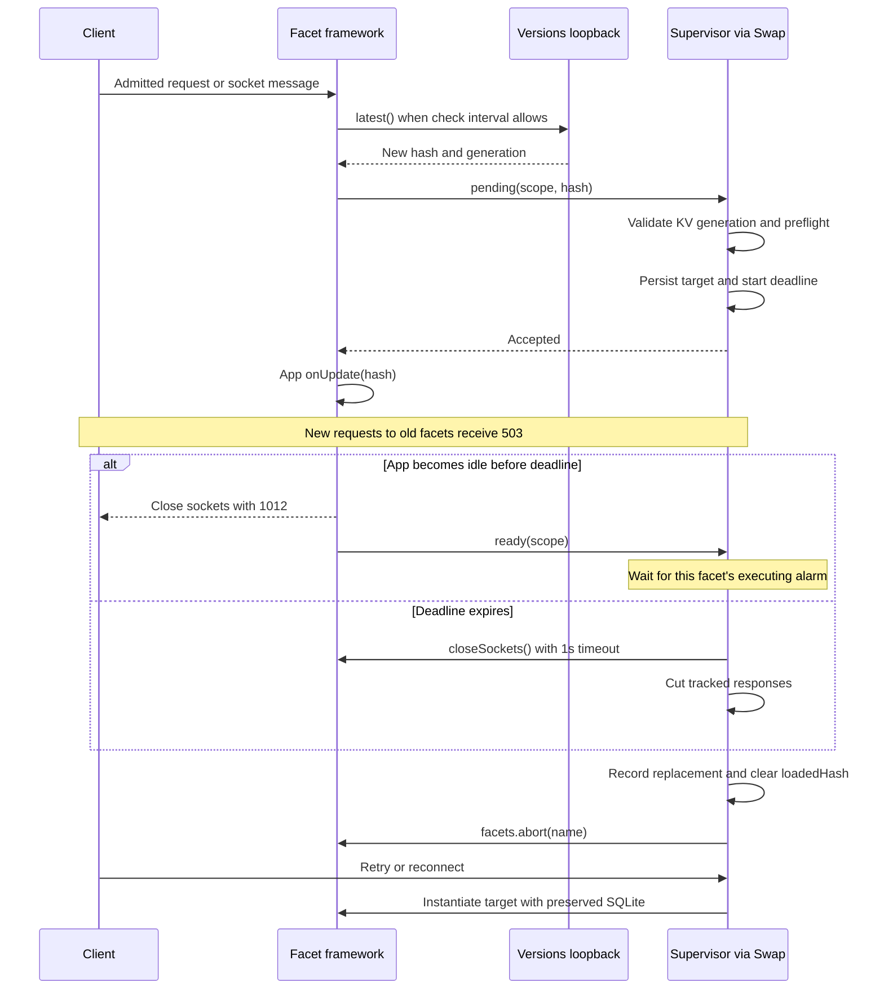
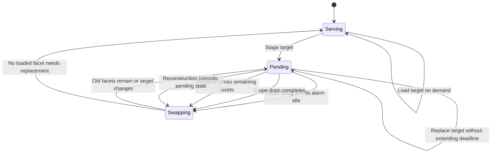
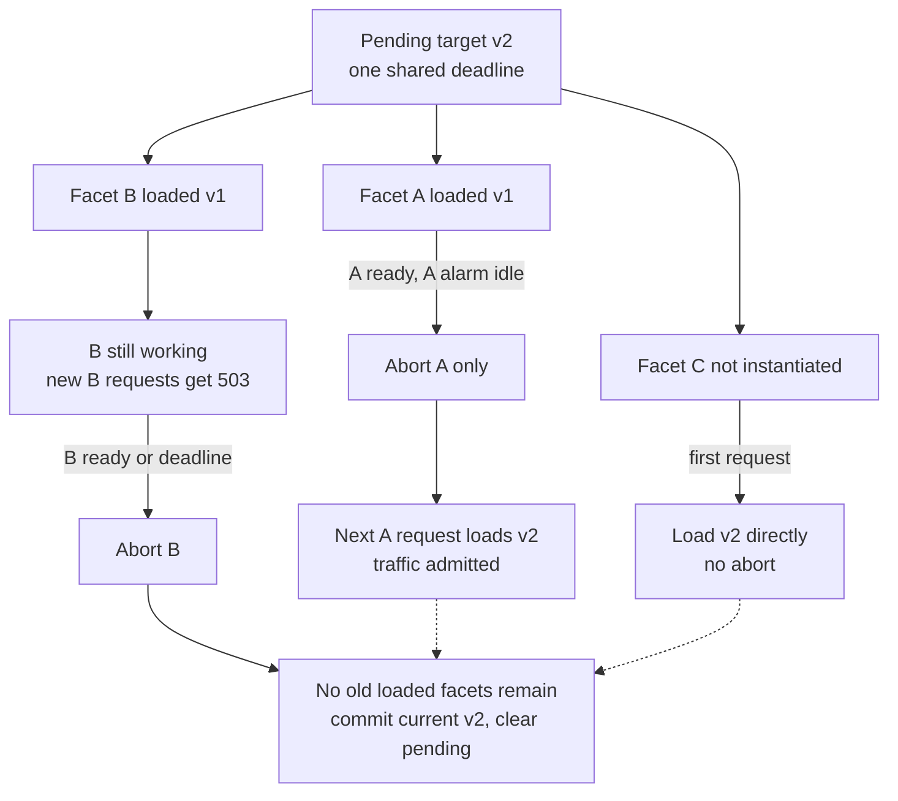
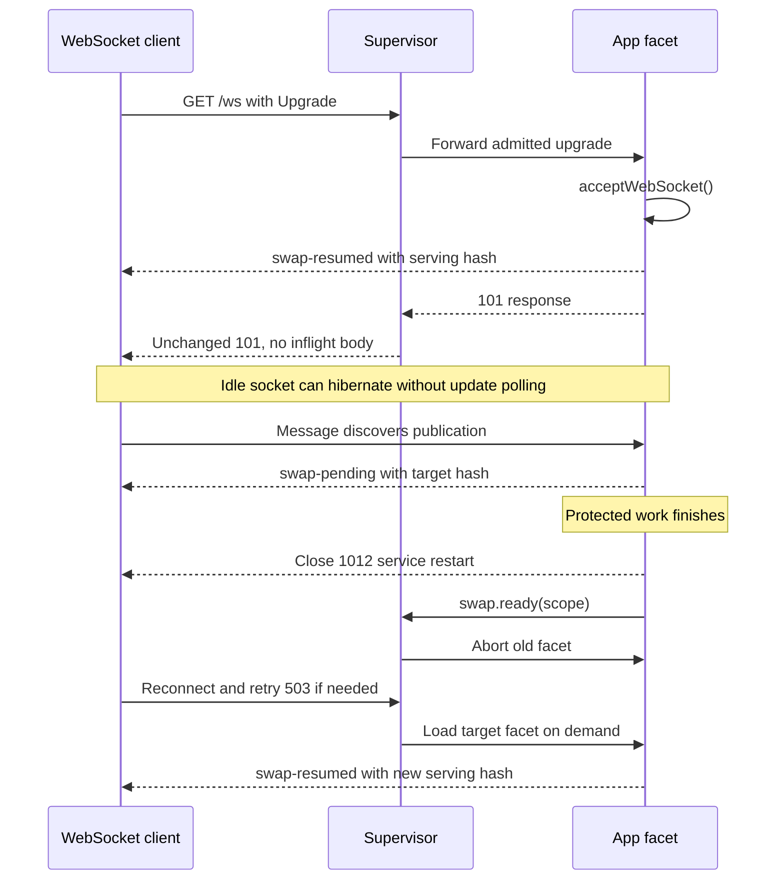
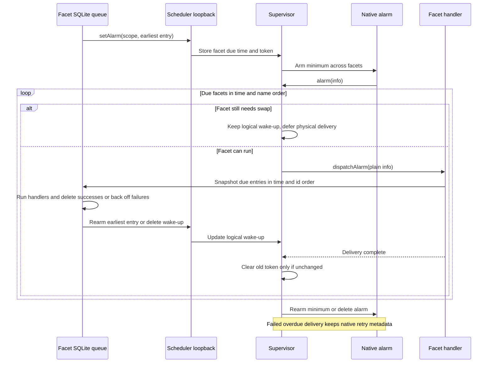

# Architecture

[Setup and demo](../README.md) · [Development](DEVELOPMENT.md)

## Purpose

facet-swap replaces application code while giving existing work time to finish. The Supervisor waits until the application is ready or a configurable deadline expires. At the deadline, it cuts off unfinished work and replaces the named facet. Each user updates independently. The facet keeps its SQLite state.

Crashes and deployment failures can still interrupt work. The same stack runs locally with `alchemy dev` and deploys to Cloudflare stages.

## The Core Idea

The entry Worker routes `/u/<user>/stream` and `/u/<user>/version` to a Supervisor selected by `getByName(user)`. Each Supervisor owns a facet named `app`.

The entry Worker, Supervisor, and application facet use a shared Hono router. It matches encoded paths exactly and lets unexpected errors reach the runtime.

User IDs are raw URL segments, so encoded IDs do not alias decoded ones. Health, publication, status, version, and stream routes accept GET and automatic HEAD. Scope control accepts PUT, notes accept GET/PUT, and alarms accept GET/PUT/DELETE. Unsupported methods on these routes return 405.

SSE handlers return raw response bodies. For HEAD requests, the shared router cancels the body before Hono removes it. This releases the Supervisor's inflight entry. The gateway accepts RPC calls only. Its HTTP handler returns 404.

The **Supervisor** runs stable code. It decides whether to admit requests and keeps response wrappers so it can signal a forced cut. It stores current and pending configurations in its own SQLite database.

The **Facet** runs the application code. Worker Loader reads its module from R2 by content hash. Its separate SQLite database survives when the Supervisor aborts and recreates the facet.

Publication needs no manual label. If one is set, the build includes it in the module as a salt. The loader passes the hash as `env.HASH` so the module does not have to contain its own hash. Both `/version` and SSE events return a 12-character hash in `v` and the full `hash`. They include `label` only when one is set.

The loader environment supplies unscoped Notes and scheduler forwarding stubs. Plain class props carry `{ supervisorId, readOnly, facet }`. The facet receives no raw resource bindings.

### Architecture

## Capabilities Instead of Raw Bindings

The gateway Worker owns the Notes R2 bucket. Its unscoped `Notes` entrypoint exposes `get`, `put`, and a revision diagnostic. Its default HTTP handler always returns 404. Only the trusted entry Worker receives the unscoped `GATEWAY` service binding. The Supervisor passes its Durable Object ID to the facet in plain props.

The entry Worker's `ScopedNotes` and `Scheduler` entrypoints forward calls. Facets with the same hash share a loader environment. It contains `HASH`, `CHECK_INTERVAL_MS`, and the unscoped `NOTES`, `SCHEDULER`, `VERSIONS`, and `SWAP` service stubs. Each facet gets `{ supervisorId, readOnly, facet }` through `getDurableObjectClass` props and passes those values to forwarding methods. Production rejects Durable Object class props that contain stubs.

`ScopedNotes` validates opaque keys and prefixes them with the supplied Supervisor ID. It rejects writes when `readOnly` is set. The facet supplies its own identity and permissions, so this design requires trusted application code. A malicious facet could lie about those values.

Integration tests check that users sharing a loader hash keep separate data and alarms. They also check that recreating a facet applies new permissions.

### Refreshing Scope

`PUT /u/<user>/__scope` accepts JSON such as `{"readOnly":true}` and stages new permissions with the **same hash**. Current and pending configurations each contain the hash, generation, and permission. If the target permission is unchanged, the route returns `{ accepted: true, changed: false }` without another drain.

The Supervisor rejects new requests with the same 503 retry response used for code updates. It waits for inflight bodies to finish or the deadline to expire, then aborts and recreates the facets. Both version headers carry the same hash during a scope-only drain. The recreated facets get the new plain props and keep their SQLite state. Revocation takes effect **after draining or at the deadline**. Keeping the same code hash does not remove the deadline.

The Supervisor handles the scope route without calling the facet. This route is an unauthenticated local test control. It is unsuitable for production authorization. User routes also lack authentication, so a client can choose another user's URL.

If application work outlives a request, the app must track that work before declaring readiness and recover it after a restart. Scope revocation still cuts it off at the deadline.

### Gateway Deployment

Add or change resource bindings on the gateway. Keep the forwarding API compatible so the Supervisor can continue using it. A new capability method also needs a method on the trusted forwarding entrypoint.

With Alchemy's local provider, a gateway-only revision change restarts Gateway and leaves Api running. The Supervisor's open stream survives. Its service channel still reports the previous gateway revision, which the integration test records.

A manual Cloudflare trial reaches the new gateway from an existing Supervisor. The stale channel has only been reproduced locally. No automated test covers production rollout.

## Publishing Is Part of the Stack

`alchemy.run.ts` declares the local R2 bucket, KV namespace, Worker Loader binding, Supervisor namespace, and entry Worker. It defines and calls `bundleFacet` and `publishFacet` during stack evaluation.

Alchemy's `Bundle.build` uses its rolldown helper to build `src/app.ts` into one ESM module. The module's SHA-256 hash determines its `code/<hash>.js` key. The aggregate bundle hash is not used. Supervisors do not re-hash loaded code, so the bucket must stay private and only this stack may write to it.

Two built-in Alchemy Actions compare their inputs with saved state. **FacetCode** saves only the content hash as its input. It writes the module through `WriteBucketLocal`. The evaluation closure supplies the bytes, so Action state does not contain the bundle.

**FacetLatest** takes the successful upload's hash output. It writes `{ hash, generation }` and version and publication metadata to KV `latest` through `WriteNamespaceLocal`. Waiting for that output keeps KV from pointing to code that has not been uploaded. Both Actions write through Alchemy's local emulators.

Each stack evaluation bundles the source to check for changes. If the module bytes are identical, it skips the R2 upload. If the hash and version inputs are identical, it skips the KV write.

Editing application source changes the hash without a label bump. Changing the optional label changes the module bytes too, so it publishes even if the source is unchanged. When neither changes, the publication metadata and upload time stay the same. Forced reconciliation reruns both Actions.

### Deploy Flow

The deploy CLI asks the running Alchemy dev process to evaluate the stack. The optional label salt changes the module bytes. The reconciliation nonce only triggers evaluation. See [Development](DEVELOPMENT.md#local-execution) for commands and salt behavior.

Changing only the application source or salt leaves the Supervisor Worker's bundle unchanged. Existing streams survive that stack reconciliation. Editing shared runtime code can redeploy the stable Workers too. For example, changing `src/router.ts` redeploys both the entry Worker and Supervisor.

## How a Supervisor Updates

**Notice.** The facet's framework code checks `versions.latest()` when a request or socket message arrives. It checks at most once per `CHECK_INTERVAL_MS`, which defaults to 10 seconds. Concurrent checks share a promise. Nothing polls in the background. The Supervisor does not poll during fetch or alarm delivery. If it has no current configuration, it bootstraps the first publication.

When the helper finds a different hash, it calls `swap.pending(hash)`. The Supervisor checks that the hash matches KV's latest publication. The generation must be a positive safe integer greater than the current one. It preflights the module without constructing a facet. If any check or preflight fails, current code keeps serving. After acceptance, the helper calls the application's `onUpdate(hash)` hook. An idle socket discovers no update until its next message.

**Grace window.** Only facets still running old code reject new requests. Those requests, including socket upgrades, receive 503 with `Retry-After: 1`, `X-Current-Version`, `X-Pending-Version`, and `Cache-Control: no-store`. Existing work continues.

The app tracks work that needs to finish and calls `ready()` when idle. Finishing a response does not tell the Supervisor that the code is ready to swap. The demo tracks requests, stream lifetimes, and alarm handlers. Open sockets do not count as protected work.

**Swap.** A trusted facet passes `{ supervisorId, facet }` to its unscoped swap stub. Calling `ready(scope)` aborts only that facet and waits for its executing alarm to finish first. Its SQLite database survives. A newly instantiated facet loads the target publication directly, even while another facet is draining.

For scope changes, the Supervisor tracks response lifetimes across all facets. Revocation waits for admitted work to finish unless the deadline expires.

The facets registry stores each facet's actual `loadedHash` and `loadedReadOnly` props. A null hash means the facet was aborted and has not been instantiated again. The Supervisor skips facets already on target and facets that have not been instantiated.

The Supervisor's current and pending configurations describe the committed and target publications. Individual facets may still run different code. Current advances and the window closes once no loaded facet needs replacement. The deadline forces only the remaining old facets, so one stuck facet does not block another's readiness or traffic. The Supervisor tracks SSE cuts and executing alarms separately for each facet.

**Deadline.** The first pending change starts a `DRAIN_DEADLINE_MS` timeout, which defaults to 30 seconds. Replacing the target does not extend it. This in-memory timer keeps the Supervisor awake and billed for wall time throughout the window. Keep the window to tens of seconds rather than minutes.

At the deadline, the Supervisor commits and aborts even if the app never signals readiness. Response wrappers try to append `event: update-abort` to SSE bodies before the abort. Its data contains `reason: "drain-deadline"`, `oldVersion`, and `newVersion`. Other response bodies error. The wrappers let the Supervisor cut responses and drain scope changes. They do not decide when application code is ready.

The timeout exists only while a change is pending. It prevents hibernation during that window. Outside it, there are no polling timers. On reconstruction, the Supervisor commits persisted pending state immediately. It cannot recover live work or the old timer.

### Update Handshake

### Swap States

These phases describe the Supervisor. During a pending window, some facets can run old code while others run the target.

### Independent Facet Replacement

### WebSockets

The facet accepts hibernatable sockets with `ctx.acceptWebSocket()` and handles their messages and closes. The Supervisor passes through the 101 response unchanged. It adds no response wrapper or inflight entry.

Aborting a facet does not close hibernated sockets in production. Before calling `swap.ready()`, the framework closes each socket with code 1012 (`service restart`). For deadline, scope-change, and restart swaps, the Supervisor calls the facet's `closeSockets()` RPC first. It allows one second per facet and aborts even if closing fails. Clients must reconnect and retry. An open socket alone never delays replacement.

`/u/<user>/ws` is a small echo demo. The initial `swap-resumed` frame and each echo include the serving hash. The update hook sends `swap-pending` before declaring readiness. The app handles its own buffering, protocol negotiation, and recovery.

### Swap History

Each facet replacement adds a row to the Supervisor's SQLite `swaps` table in the same transaction as the current/pending configuration change. The table keeps the latest 100 rows. Initial activation also adds a row, with null values for the facet and old hash. This history helps diagnose swaps. It does not support rollback.

`GET /u/<user>/__status?swaps=20` returns `{ current, pending, pendingSince, inflight, swapping, swaps }`. Swap rows appear newest first. With no pending configuration, `pendingSince` is null.

The `swaps` count defaults to 20. It must be a non-negative safe integer and is capped at 100. Use `swaps=0` to omit history rows. Invalid values return 400.

Reading status skips admission and update checks, so it never triggers an update. HEAD returns no response body. Other methods return 405.

Rows contain `id`, `facet`, `oldHash`, `newHash`, `kind`, `pendingSince`, `swappedAt`, `forced`, `abortedStreams`, and `restartCommit`. The `kind` is `code` when the hash changes, including combined code/scope changes. A same-hash configuration commit has kind `scope`.

Timestamps use epoch milliseconds. Subtract `pendingSince` from `swappedAt` for the drain duration. Replacing a pending target keeps the original pending time.

`forced` marks a deadline swap. `abortedStreams` counts response bodies still tracked at that deadline, including non-SSE bodies. It excludes alarm handlers and requests still awaiting headers.

`restartCommit` marks pending state committed during Supervisor reconstruction. Those commits are not forced. No active streams can be recovered. If the saved pending configuration has no timestamp, the row uses the commit time for `pendingSince`.

## Alarms Through the Supervisor

Facets cannot own native alarms. They call the unscoped loopback stub `env.SCHEDULER` supplied by the loader. Its methods are `setAlarm(scope, time)`, `getAlarm(scope)`, and `deleteAlarm(scope)`. The trusted facet passes `{ supervisorId, facet }` as the scope. Each facet has one logical wake-up. Its typed queue uses that wake-up to run multiple application timers.

Each facet's registry row in the Supervisor's SQLite stores a due time and a unique scheduling token. The Supervisor sets its native alarm to the earliest due time across facets. It deletes the alarm when no wake-ups remain. Outside delivery, it updates the row and native alarm in one transaction.

During delivery, handlers update their logical wake-ups. The Supervisor rearms the native alarm after the delivery loop. If an overdue wake-up fails, it keeps the existing native retry and its metadata. Code swaps, scope changes, and Supervisor reconstruction leave the schedule intact.

`getAlarm()` reports the logical due time even if draining postpones the native alarm. While that delivery is executing, it returns null unless the handler has scheduled a replacement. A unique token distinguishes the replacement from the executing wake-up, even when both use the same timestamp.

When `Supervisor.alarm()` fires, it loads due facets one at a time without checking KV. Alarm-only traffic keeps current code until a request or socket message discovers a publication. If one facet's RPC fails, the Supervisor still tries the others. It keeps the failed row for native retry, rearms the alarm, then rethrows the first failure.

During a pending drain, it postpones only old facets' wake-ups by two seconds. This neither consumes the logical alarm nor extends the drain deadline. After a swap, the next delivery loads current code.

An executing handler delays only its own facet's code swap. Scope changes wait for handlers along with other admitted work. A deadline abort rejects the old handler but keeps its durable alarm record for retry. Persisted native alarms and retries recover delivery across Supervisor restarts.

Cloudflare reserves `alarm` on Durable Object RPC stubs, so the Supervisor calls `F.dispatchAlarm(info)`. That method invokes `F.alarm(info)`. The runtime's invocation metadata cannot be serialized directly. The Supervisor copies it into a plain object with the logical scheduled time and native retry information.

The facet's `Alarms` module stores typed JSON entries in SQLite with a time index. Scheduling or cancelling an entry rearms the Supervisor for the earliest entry. An empty queue deletes its wake-up.

Due entries run in time and insertion order. Success deletes the entry. Each failed entry retries independently, including entries with unknown types. Exponential backoff starts at one second and caps at one hour. After ten failed attempts, the queue drops the entry and logs an error. Handlers can schedule more work. New entries run on a later wake-up.

Delivery is at least once. Aborts and failures can repeat completed effects, so handlers must be idempotent. Errors in the queue infrastructure reach Cloudflare's native retries. Handler failures use the facet queue's retry schedule. Cancellation does not undo running work.

The demo exposes the queue at `GET/PUT/DELETE /u/<user>/alarm`. PUT accepts `{type,time,payload}` and returns `{id}`. The supported types are `reminder` with `{text}` and `cleanup` with `{key}`. DELETE accepts `?id=`. GET returns `alarms`, the persistent delivery `count`, and `last`. The last delivery includes the handling code hash, type, and payload.

## State and Forward-Only Changes

The Supervisor persists current and pending code/scope configurations. It cannot persist active requests or the timer, and it has no waiting-request queue. Saving current before abort lets a restarted Supervisor load the intended code.

On wake, it commits any recovered pending configuration immediately because there is no recoverable inflight work to drain. A crash can still drop open streams without a final abort event. Clients schedule their own retries.

The facet stores its typed alarm queue and handler effects. The Supervisor stores only the next wake-up. Application state lives in the facet's SQLite database. The demo increments a served counter before each stream starts. It increments once per stream, not per event. The counter survives code replacement.

A long-running app must periodically checkpoint its work in the **facet itself**. The Supervisor does not do this automatically. The demo saves its counter but has no resumable stream checkpoints or migration framework. Application migrations should be repeatable and work with forward-only updates.

There is no rollback or canary path. To fix a faulty release, publish another version. The Supervisor requires increasing publication generations. Hashes have no order, so an older hash can be published with a newer generation.

Each publish reads the generation in KV `latest` and writes `max(now, previous + 1)`. The generation advances even if the clock stalls or moves backward, or a publish is interrupted. Use one serialized deploy writer with shared Alchemy state. Independent state stores or lost deployment state cannot guarantee global ordering.

## Limits and Safety

Keep both runtime servers on loopback. Do not tunnel them. Only trusted local code should publish facets.

The dynamic worker environment contains its hash and unscoped Notes/scheduler forwarding stubs. Each trusted facet gets identity and permissions through plain class props. Neither receives raw R2, KV, or namespace bindings. The worker has `globalOutbound = null`. These restrictions are insufficient for a hardened multi-tenant sandbox.

Actions compare inputs with saved state. They do not check whether storage has changed independently. If emulator data is deleted without updating Alchemy state, force reconciliation. Old R2 code objects stay available for Supervisors that have not updated.

Local KV does not reproduce production propagation delay. It does not cover crash-safe request recovery or production authentication. Source-map publication and billing validation are not implemented.

If preflight fails, current code keeps serving. Errors after a successful swap still reach the runtime. There is no automatic rollback.
