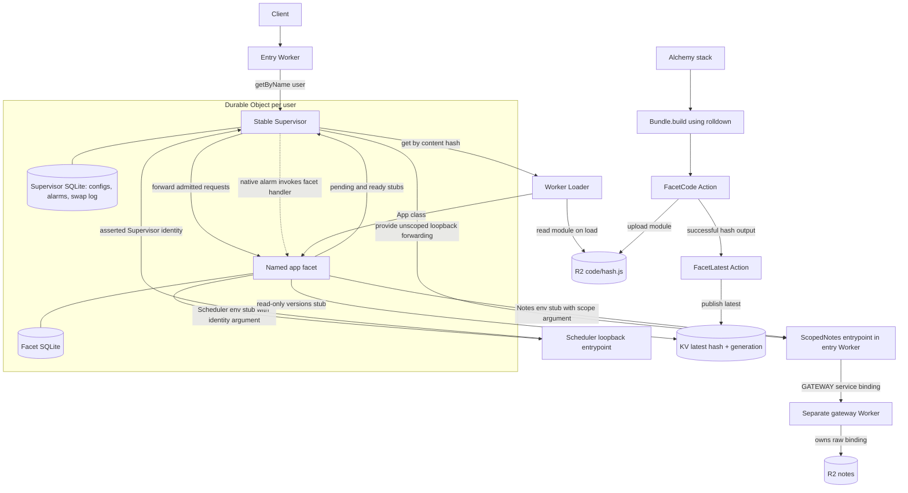
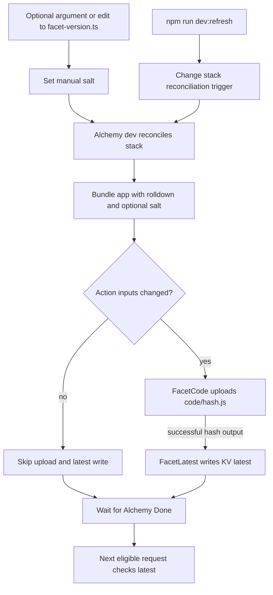

# Architecture

[Setup and demo](../README.md) · [Development](DEVELOPMENT.md)

## Purpose

This local prototype changes application code with a bounded drain. A stable Supervisor lets current work finish before replacing a named application facet, up to a configurable deadline. Work still running at the deadline is cut to bound the drain window. Each user updates independently, and the facet's SQLite-backed state survives replacement.

This is a demonstration of controlled code replacement, not a guarantee against crashes or arbitrary deployment failures. The checked-in stack runs in Alchemy's local environment and rejects non-dev execution.

## The Core Idea

The entry Worker routes `/u/<user>/stream` and `/u/<user>/version` to a Supervisor selected by `getByName(user)`. Each Supervisor owns a facet named `app`.

HTTP routing uses Hono in the entry Worker, Supervisor, and application facet. The shared router keeps exact, encoded path matching and propagates unexpected errors to the runtime.

User IDs are raw URL segments, so encoded IDs do not alias decoded ones. Health, publication, status, version, and stream routes accept GET and automatic HEAD. Scope control accepts PUT, notes accept GET/PUT, and alarms accept GET/PUT/DELETE. Unsupported methods on these routes return 405.

SSE handlers return raw response bodies. The shared router cancels discarded HEAD bodies before Hono strips them, releasing Supervisor inflight tracking. The gateway exposes RPC only; its HTTP handler returns 404.

The **Supervisor** has stable code. It handles admission, preserves forced-cut response hints, and persists the current and pending configurations in its own SQLite-backed storage.

The **Facet** contains the application logic. Worker Loader loads its module by content hash from R2. The facet has a separate SQLite database, preserved when the Supervisor aborts and recreates it. An optional manual label is compiled into the module as a salt; no label is needed for publication. Its hash is passed as `env.HASH`, avoiding a self-referential hash. Both `/version` and SSE events show a 12-character hash in `v`, the full `hash`, and a `label` only when one is set. It receives unscoped Notes and scheduler forwarding stubs through its loader environment and plain `{ supervisorId, readOnly, facet }` class props, not raw resource bindings.

### Architecture

## Capabilities Instead of Raw Bindings

The gateway Worker owns the Notes R2 bucket and exports an unscoped `Notes` entrypoint with `get`, `put`, and a revision diagnostic. Its default HTTP handler always returns 404. Only the trusted entry Worker receives the unscoped `GATEWAY` service binding; the Supervisor supplies its Durable Object ID through plain facet props.

The entry Worker exports thin `ScopedNotes` and `Scheduler` forwarding entrypoints. The hash-shared loader environment contains `HASH`, `CHECK_INTERVAL_MS`, and unscoped `NOTES`/`SCHEDULER`/`VERSIONS`/`SWAP` service stubs. Each facet receives plain `{ supervisorId, readOnly, facet }` through `getDurableObjectClass` props and passes that scope to forwarding methods. Production rejects stub-valued Durable Object class props.

`ScopedNotes` prefixes keys with the supplied Supervisor ID, validates opaque keys, and rejects writes when `readOnly` is set. The facet asserts its own identity and permissions; this is acceptable because application code is trusted, not an isolation boundary against malicious facets. Integration tests exercise per-user isolation with a shared loader hash, alarm isolation, and refreshed permissions after abort.

### Refreshing Scope

The trusted local control route `PUT /u/<user>/__scope` with JSON `{"readOnly":true}` stages a new configuration with the **same hash**. Current and pending configurations include hash, generation, and permission. An unchanged target permission returns `{ accepted: true, changed: false }` without starting another drain. Scope refresh closes admission with the same 503 retry response as a code update, waits for inflight bodies to finish or the drain deadline, and uses the same abort/recreate path. Both version headers carry the same hash during a scope-only drain. The recreated facet receives the new plain scope props; its SQLite state survives. A revocation therefore takes effect **after draining or at the deadline**, not immediately. The deadline also applies when the code hash stays the same.

The scope route never reaches the facet. It is unauthenticated local test machinery, not a production authorization API. User routes themselves also lack authentication; capability confinement does not prevent a client from choosing another user's URL. Application work outside request lifetimes must participate in readiness and recovery; scope revocation still has a hard deadline.

### Gateway Deployment Boundary

Adding or changing real resources belongs on the gateway, not the Supervisor. The forwarding API must remain compatible; adding entirely new capability methods still requires teaching the trusted forwarding entrypoint how to expose them.

In Alchemy's local provider, a gateway-only revision change restarts Gateway while Api keeps its existing instance. The Supervisor's open stream survives, but its service channel continues reporting the previous gateway revision. The integration test records this limitation. A manual Cloudflare trial reaches the new gateway from an existing Supervisor; the stale channel is reproducible only locally so far. There is no automated production rollout test.

## Publishing Is Part of the Stack

`alchemy.run.ts` declares the local R2 bucket, KV namespace, Worker Loader binding, Supervisor namespace, and entry Worker. It defines and calls `bundleFacet` and `publishFacet` during stack evaluation.

Alchemy's `Bundle.build` uses its rolldown helper to produce one ESM module from `src/app.ts`. The file's SHA-256 hash, not the aggregate bundle hash, addresses `code/<hash>.js`. Supervisors do not re-hash what they load; content-address integrity relies on the bucket being private and written only by this stack.

Publication uses two built-in, diffed Alchemy Actions. **FacetCode** takes only the content hash as its persisted, diffed input and writes the module through `WriteBucketLocal`. Module bytes come from the evaluation closure, so the bundle does not enter Action state. **FacetLatest** consumes the upload's successful hash output and writes `{ hash, generation }` to KV `latest`, with version and publication metadata, through `WriteNamespaceLocal`. This dependency prevents publication before the code object exists. Both write through Alchemy's local emulators.

Each stack evaluation bundles the source to discover changes. Identical module bytes skip the R2 upload, and identical hash/version inputs skip the KV write. Editing application source changes the hash without a label bump. Changing the optional label also changes the module bytes, so it forces publication even when the source is unchanged. Unchanged source and label leave both publication metadata and upload time unchanged. A forced reconciliation deliberately reruns the Actions.

### Deploy Flow

The deploy CLI requests stack evaluation while Alchemy dev is running. The optional label salt changes module bytes; the reconciliation nonce only triggers evaluation. See [Development](DEVELOPMENT.md#local-execution) for commands and salt behavior.

Changes confined to the application source or salt leave the Supervisor Worker's bundle unchanged, so existing streams survive stack reconciliation. Shared runtime dependencies can also change the stable Workers; editing `src/router.ts`, for example, redeploys both the entry Worker and Supervisor.

## How a Supervisor Updates

**Notice.** Framework code shipped with the facet checks `versions.latest()` on each request and socket message, at most once per `CHECK_INTERVAL_MS` (10 seconds by default). Concurrent checks share a promise. There is no background polling, and the Supervisor does not poll in fetch or alarm delivery. The Supervisor bootstraps the first publication when a Supervisor has no current configuration.

A different hash calls `swap.pending(hash)`. The Supervisor validates the exact hash against KV's latest publication, requires a higher positive safe-integer generation, and preflights the module without constructing the facet. Failed checks and preflights keep current code serving. The helper then notifies the application's `onUpdate(hash)` hook. An idle socket detects nothing until its next message.

**Grace window.** Pending code closes admission only for facets still running old code. New requests, including socket upgrades, get 503 with `Retry-After: 1`, `X-Current-Version`, `X-Pending-Version`, and `Cache-Control: no-store`. Existing work continues. The application tracks protected operations and calls `ready()` when idle; the Supervisor does not infer code readiness from response completion. The demo tracks requests, stream lifetimes, and alarm handlers, but not open sockets.

**Swap.** Each trusted facet passes `{ supervisorId, facet }` to its unscoped swap stub. Its `ready(scope)` aborts only that facet, after its executing alarm finishes. SQLite survives. New instantiations load the publication target directly, including during another facet's window. Scope changes retain Supervisor response-lifetime draining across all facets, so revocation does not cut admitted work before the deadline.

The facets registry records the actual `loadedHash` and `loadedReadOnly` props; a null hash marks an aborted facet awaiting instantiation. Already-target and uninstantiated facets are never aborted. Supervisor-wide current/pending describe the committed and target publication, not every facet's running code. Current advances and the window closes when no loaded facet needs replacement. The shared deadline forces only the remaining old facets; one stuck facet does not block another's readiness or traffic. SSE cuts and alarm gates are tracked per facet.

**Deadline.** The first pending change starts a `DRAIN_DEADLINE_MS` timeout (30 seconds by default). Replacing the target never extends it. The deadline runs as an in-memory timer, which keeps the Supervisor awake (and billed for wall time) for the whole window, so keep it short: tens of seconds, not minutes. If the app never signals readiness, the Supervisor commits and aborts anyway. Retained response wrappers append a best-effort `event: update-abort` to SSE bodies before abort; data contains `reason: "drain-deadline"`, `oldVersion`, and `newVersion`. Other bodies error. These wrappers support cuts and scope drains, not code-readiness decisions.

The timeout exists only during a pending window. It prevents hibernation then, but there are no polling timers outside the window. Persisted pending state is committed on reconstruction; live work and the timer are not crash-recoverable.

### WebSockets

The facet accepts hibernatable sockets with `ctx.acceptWebSocket()` and handles their messages and closes. The Supervisor returns a 101 response unchanged, without a response wrapper or inflight entry. Facet abort does not close hibernated sockets in production. The framework explicitly closes each socket with code 1012 (`service restart`) before calling `swap.ready()`. For deadline, scope-change, and restart swaps, the Supervisor first invokes the facet's `closeSockets()` RPC, best-effort with a one-second timeout per facet, then aborts even if closing fails. Clients reconnect and handle retries. A socket never delays replacement by itself.

`/u/<user>/ws` is a small echo demo. Its initial `swap-resumed` frame and each echo include the serving hash. The update hook emits `swap-pending` before readiness. Application-specific buffering, protocol negotiation, and recovery belong to the app.

### Swap History

Each facet replacement appends a row to the Supervisor's own SQLite `swaps` table, atomically with the current/pending configuration change. It retains only the latest 100 rows. Initial activation is included with a null facet and old hash; this is diagnostic history, not a rollback mechanism.

`GET /u/<user>/__status?swaps=20` returns `{ current, pending, pendingSince, inflight, swapping, swaps }`, with swap rows newest first. `pendingSince` is null when no configuration is pending. The `swaps` count defaults to 20, must be a non-negative safe integer, and is capped at 100; `swaps=0` omits history rows, and invalid values return 400. This read-only route bypasses update checks and admission, so reading it never triggers an update. Other methods return 405 (HEAD reads without a response body).

Rows contain `id`, `facet`, `oldHash`, `newHash`, `kind` (`code` for a hash change, `scope` for a same-hash configuration commit), `pendingSince`, `swappedAt`, `forced`, `abortedStreams`, and `restartCommit`. Timestamps are epoch milliseconds; subtract them for drain duration. The original pending time survives replacement of a pending target. A combined code/scope change is classified as code.

`forced` marks the deadline path. `abortedStreams` counts response bodies still tracked at that deadline, including non-SSE bodies, but not alarm handlers or requests awaiting headers. `restartCommit` marks pending state committed during Supervisor reconstruction; those commits are not forced and have no recoverable active streams. If a persisted pending configuration has no timestamp, the row uses the commit time as its pending time.

## Alarms Through the Supervisor

Facets cannot own native alarms. The loader supplies `env.SCHEDULER`, an unscoped loopback service stub. Its `setAlarm(scope, time)`, `getAlarm(scope)`, and `deleteAlarm(scope)` methods receive `{ supervisorId, facet }` from the trusted facet. Each facet has one logical wake-up, and its typed queue multiplexes application timers onto it.

The due time and a unique scheduling token live on each facet's registry row in the Supervisor's SQLite. The native alarm is armed for the minimum time across facets, or deleted when none remain. Outside delivery, updating a row and the native alarm share a transaction. During delivery, handlers update logical wake-ups and the Supervisor rearms after the loop; an overdue failed wake-up uses the existing native retry so its retry metadata is preserved. Neither a code/scope swap nor Supervisor reconstruction resets the schedule. `getAlarm()` reports the logical due time, even when the physical alarm was postponed for draining; while that delivery is executing it returns null unless the handler has scheduled a replacement. Tokens keep a handler's rearm safe even when it uses the same timestamp.

When the native `Supervisor.alarm()` fires, it loads due facets serially without checking KV. Alarm-only traffic keeps current code until a request or socket message discovers a publication. One facet's RPC failure does not block the others; its row remains for native retry, and the first failure is rethrown after rearming. Pending drains postpone only old facets' wake-ups by two seconds without consuming the logical alarm or extending the hard drain timer. After swapping, the next delivery loads current code. Executing handlers gate only their own facet's code swap; scope changes drain them with other admitted work. A deadline abort rejects the old handler and leaves its durable alarm record for retry. Native alarm persistence and retries recover delivery across Supervisor restarts.

Cloudflare reserves `alarm` on Durable Object RPC stubs. A tiny `F.dispatchAlarm(info)` bridge therefore invokes `F.alarm(info)`. The Supervisor copies the runtime's non-serializable invocation metadata into a plain object, preserving the logical scheduled time and native retry information.

The facet's `Alarms` module stores typed JSON entries in SQLite, indexed by time. Scheduling and cancellation rearm the Supervisor for the earliest entry, or delete its wake-up when empty. Due entries run in time and insertion order. Successful entries are deleted; failures, including unknown types, retry independently with exponential backoff starting at one second and capped at one hour. After ten failed attempts an entry is dropped with an error log. Handlers may schedule more work; newly scheduled entries run on a subsequent wake-up.

Delivery is at least once. Handlers must be idempotent because aborts and failures can repeat completed effects. Queue infrastructure errors propagate to Cloudflare's native retries; handler failures use the facet queue's retry schedule. Cancellation does not undo running work.

The demo's `GET/PUT/DELETE /u/<user>/alarm` exposes the queue. PUT accepts `{type,time,payload}` and returns `{id}`; types are `reminder` with `{text}` and `cleanup` with `{key}`. DELETE accepts `?id=`. GET returns `alarms`, persistent delivery `count`, and `last` with the handling code hash, type, and payload.

## State and Forward-Only Changes

Current and pending code/scope configurations are durable; active requests and the timer are not. There is no waiting-request queue. Persisting current before abort lets a restarted Supervisor select the intended code. A pending configuration recovered on wake is committed immediately because there is no recoverable inflight set to drain. A Supervisor crash can still lose open streams without a final abort event. Retry scheduling belongs to clients, not Supervisor memory.

The typed alarm queue and handler effects belong to facet storage; the Supervisor stores only the next wake-up. Application state belongs in the facet's SQLite database. The demo writes a served counter before starting each stream, once per stream rather than once per event. The counter survives code replacement.

For a real long-running application, the **facet itself** must checkpoint meaningful work periodically. The Supervisor does not provide automatic checkpoints. This demo persists its counter, but does not implement resumable stream checkpoints or a migration framework. Application migrations should be repeatable and compatible with forward-only updates.

There is no rollback or canary path. A faulty release is corrected by publishing another version. The Supervisor enforces monotonically increasing publication generations, not ordered content hashes. Deliberately publishing an older hash with a newer generation is allowed. Each publish reads the generation in KV `latest` and writes `max(now, previous + 1)`, so stalled/regressing clocks and interrupted publishes still advance it. Use one serialized deploy writer sharing the same Alchemy state; independent state stores or lost deployment state cannot guarantee global ordering.

## Limits and Safety

Keep both runtime servers on loopback and do not tunnel them. Only trusted local code should publish facets. The dynamic worker environment contains its hash and unscoped Notes/scheduler forwarding stubs; each trusted facet receives identity and permissions through plain class props. Neither receives raw R2, KV, or namespace bindings, and the worker has `globalOutbound = null`. These restrictions do not make this prototype a hardened multi-tenant sandbox.

Actions diff inputs rather than checking for storage drift. Deleting emulator data independently of Alchemy state requires a forced reconciliation. Old R2 code objects are retained for Supervisors that have not updated.

Local KV does not reproduce production propagation delay. Crash-safe request recovery, production authentication, source-map publication, billing validation, and production rollout are outside this prototype. Preflight failures retain the current code. Errors after a successful swap still propagate; there is no automatic runtime rollback.
